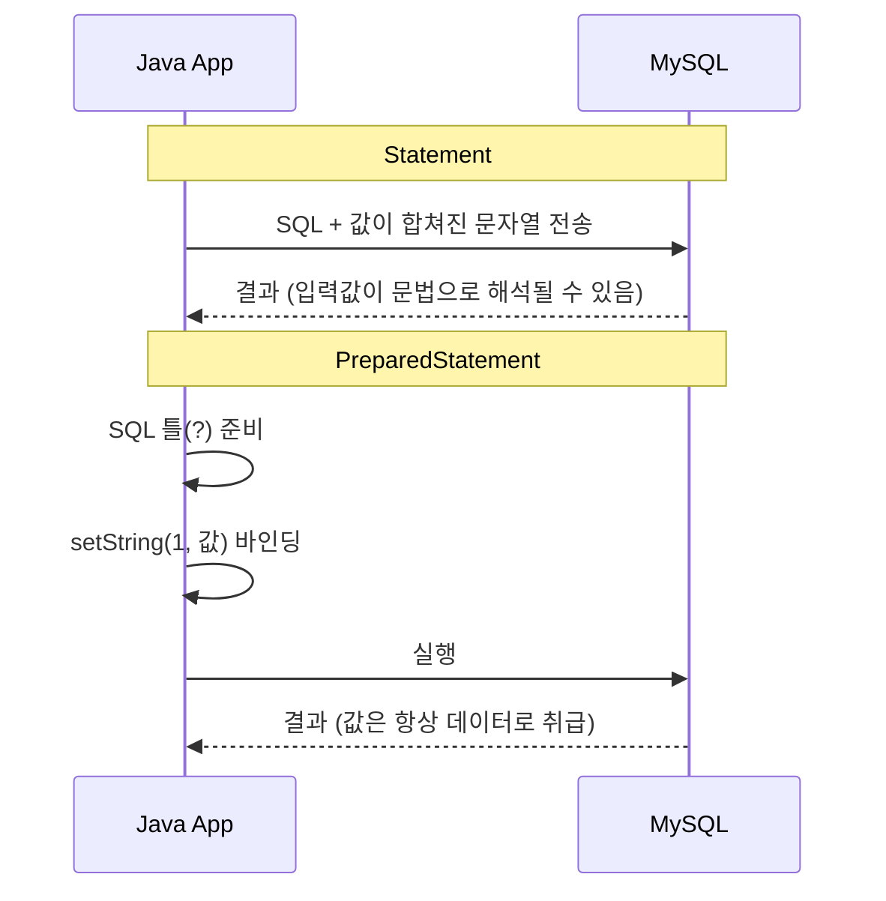
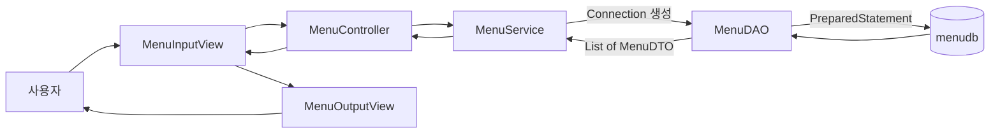

## 들어가며 (Situation)

JDBC 첫 챕터에서 `DriverManager`로 MySQL(`menudb`)에 연결하는 것까지 해봤다. 이번에는 그 연결 위에서 **실제로 SQL을 실행하고 결과를 Java 객체로 받아오는 것**이 목표였다.

- `chap02-statement` : `Statement` → `PreparedStatement` → XML로 쿼리 분리 → `executeUpdate()`
- `chap03-crud` : 지금까지 `main()` 하나에 몰아 쓰던 코드를 View / Controller / Service / DAO 계층으로 쪼개기

## 문제 상황 (Task)

처음 작성한 코드는 "돌아가긴" 했지만, 하나씩 짚어보니 문제가 많았다.

| 문제 | 어디서 드러났나 |
|------|----------------|
| 사용자 입력을 SQL 문자열에 그대로 이어 붙임 | `"... WHERE MENU_NAME = '" + menuName + "'"` |
| 쿼리가 길어지면 문자열 합치기가 지저분해짐 | JOIN, WHERE 조건이 늘어날 때 |
| `finally`에서 자원 3개를 매번 수동으로 `close()` | 모든 `Application` 클래스 |
| 입력·DB 접근·출력이 `main()` 하나에 섞여 있음 | 기능이 늘어날수록 수정 범위가 커짐 |

## 해결 과정 (Action)

### 1. Statement와 ResultSet — 일단 조회해보기

JDBC의 핵심 인터페이스 두 개부터 시작했다.

| 인터페이스 | 역할 | 얻는 방법 |
|-----------|------|----------|
| `Statement` | SQL을 담아서 실행 | `con.createStatement()` |
| `ResultSet` | 실행 결과(결과 집합) | `stmt.executeQuery(sql)`의 반환값 |

둘 다 인터페이스라서 `new`로 만들 수 없고, `Connection`이 만들어 준다.

```java
Connection con = getConnection();
Statement stmt = null;
ResultSet rset = null;

try {
    stmt = con.createStatement();
    rset = stmt.executeQuery("SELECT * FROM TBL_MENU");

    // next() : 다음 행이 있으면 커서를 옮기고 true, 없으면 false
    while (rset.next()) {
        System.out.println(
                rset.getString("MENU_NAME") + " 은/는 "
                + rset.getString("MENU_PRICE") + "원 입니다. "
        );
    }
} catch (SQLException e) {
    throw new RuntimeException(e);
} finally {
    close(con);
    close(rset);
    close(stmt);
}
```

`ResultSet`의 커서는 처음에 **첫 행 바로 앞**에 있다. 그래서 `next()`를 먼저 호출해야 첫 행을 읽을 수 있고, 결과가 여러 행이면 `while`, 한 행이면 `if`를 쓴다.


### 2. 출력에서 끝내지 않고 DTO에 담기

출력만 하면 그 데이터로 아무것도 할 수 없다. 한 행을 `MenuDTO` 하나에 담고, 여러 행은 `List<MenuDTO>`에 모았다.

```java
List<MenuDTO> menuAll = new ArrayList<>();

while (rset.next()) {
    MenuDTO menu = new MenuDTO();
    menu.setMenuCode(rset.getInt("MENU_CODE"));
    menu.setMenuName(rset.getString("MENU_NAME"));
    menu.setMenuPrice(rset.getInt("MENU_PRICE"));
    menu.setCategoryCode(rset.getInt("CATEGORY_CODE"));
    menu.setOrderableStatus(rset.getString("ORDERABLE_STATUS").charAt(0));
    menuAll.add(menu);
}
```

DTO의 기본 구성은 **필드 / 기본 생성자 / 전체 필드 생성자 / Getter·Setter / toString** 다섯 가지로 정리했다.

### 3. 시행착오 — 문자열 연결 SQL의 함정

메뉴 이름을 입력받아 조회하는 실습에서 처음엔 이렇게 썼다.

```java
rset = stmt.executeQuery(
    "SELECT MENU_CODE, MENU_PRICE, ORDERABLE_STATUS FROM TBL_MENU WHERE MENU_NAME = '"
    + menuName + "'"
);
```

작은따옴표를 직접 붙여야 해서 불편한 것도 문제지만, 더 큰 문제는 **입력값이 SQL 문법의 일부가 된다**는 점이다. 예를 들어 사용자가 아래처럼 입력하면(예시 입력),

```text
' OR '1'='1
```

실제로 실행되는 SQL은 다음과 같이 바뀐다.

```sql
SELECT ... FROM TBL_MENU WHERE MENU_NAME = '' OR '1'='1'
```

조건이 항상 참이 되어 모든 행이 조회된다. 이것이 **SQL Injection**이다.

### 4. PreparedStatement와 placeholder(`?`)

`PreparedStatement`는 SQL의 틀을 먼저 만들고, 값은 `?` 자리에 `setXxx()`로 따로 채운다.

```java
pstmt = con.prepareStatement(
    "SELECT MENU_CODE, MENU_PRICE, ORDERABLE_STATUS FROM TBL_MENU WHERE MENU_NAME = ?"
);
pstmt.setString(1, menuName);   // parameterIndex는 1부터 시작
rset = pstmt.executeQuery();    // 인자 없이 실행
```

값은 SQL 문법이 아니라 **데이터로만** 바인딩되므로 `' OR '1'='1`을 넣어도 "그런 이름의 메뉴"를 찾을 뿐이다.



| 항목 | Statement | PreparedStatement |
|------|-----------|-------------------|
| 값 삽입 방식 | 문자열 연결 | `?` + `setXxx()` |
| 따옴표 처리 | 직접 | 드라이버가 처리 |
| SQL Injection | 취약 | 방어 |
| 실행 메서드 | `executeQuery(sql)` | `executeQuery()` |
| 같은 SQL 반복 실행 | 매번 새 문자열 | 객체 재사용 가능 |

> **성능에 대해 한 가지 짚고 넘어갈 점**
> 수업에서는 "PreparedStatement는 최초 1회 컴파일 후 재사용하므로 빠르다"고 배웠다. 개념적으로는 맞지만, MySQL Connector/J는 기본값이 `useServerPrepStmts=false`라서 **기본 설정에서는 클라이언트 측에서 값을 치환해 전송**한다. 서버 측 컴파일·재사용 효과를 얻으려면 `useServerPrepStmts=true` 같은 연결 옵션을 따로 켜야 한다. ([Connector/J 설정 문서](https://dev.mysql.com/doc/connector-j/en/connector-j-connp-props-prepared-statements.html))
> 그래서 PreparedStatement를 쓰는 1순위 이유는 성능보다 **보안과 가독성**이라고 정리했다.

### 5. 긴 SQL은 XML로 분리하기

쿼리에 JOIN이나 조건이 붙으면 Java 문자열 안에서 줄바꿈·공백 관리가 괴롭다. `java.util.Properties`는 XML 형식도 읽을 수 있어서(`loadFromXML`), 쿼리를 파일로 뺐다.

```xml
<?xml version="1.0" encoding="UTF-8" ?>
<!DOCTYPE properties SYSTEM "http://java.sun.com/dtd/properties.dtd">
<properties>
    <entry key="findMenuByMenuName">
        SELECT * FROM TBL_MENU WHERE MENU_NAME = ?
    </entry>
    <entry key="modifyMenuPriceByMenuName">
        UPDATE TBL_MENU SET MENU_PRICE = ? WHERE MENU_NAME = ?
    </entry>
</properties>
```

```java
Properties prop = new Properties();
prop.loadFromXML(new FileInputStream(
        "src/main/java/com/wanted/b_preparedstatements/menu-query.xml"));
String query = prop.getProperty("findMenuByMenuName");
pstmt = con.prepareStatement(query);
```

### 6. 조회와 변경은 실행 메서드가 다르다

| 구분 | SQL | 메서드 | 반환 |
|------|-----|--------|------|
| Read | `SELECT` | `executeQuery()` | `ResultSet` |
| Create / Update / Delete (DML) | `INSERT` / `UPDATE` / `DELETE` | `executeUpdate()` | `int` (영향받은 행 수) |

```java
pstmt = con.prepareStatement(prop.getProperty("modifyMenuPriceByMenuName"));
pstmt.setInt(1, price);
pstmt.setString(2, menuName);

int result = pstmt.executeUpdate();

if (result > 0) {
    System.out.println(menuName + " 메뉴 가격 수정 성공!! (영향 받은 행 : " + result + ")");
} else {
    System.out.println(menuName + " 메뉴 가격 변경 실패!! 메뉴 이름을 다시 확인해주세요");
}
```

없는 메뉴 이름을 넣으면 예외가 나는 게 아니라 **0이 반환**된다. 성공 여부를 반환값으로 판단해야 하는 이유다.

### 7. 시행착오 — 자원 해제 순서와 try-with-resources

chap02 코드를 다시 보니 `finally`에서 `close(con)`을 가장 먼저 호출하고 있었다. 자원은 **만든 순서의 역순**(`ResultSet` → `Statement` → `Connection`)으로 닫는 것이 원칙인데, 매번 손으로 쓰다 보니 순서를 신경 쓰지 못했다.

chap03에서는 `try-with-resources`로 이 문제를 없앴다. `try()` 괄호 안에 선언한 `AutoCloseable` 자원은 블록이 끝날 때 **선언의 역순으로 자동으로** 닫힌다.

```java
// MenuService
try (Connection con = JDBCTemplate.getConnection()) {
    return new MenuDAO(con).findAll();
} catch (SQLException e) {
    throw new RuntimeException(e);
}
```

```java
// MenuDAO
try (PreparedStatement pstmt = connection.prepareStatement(query)) {
    ResultSet rset = pstmt.executeQuery();
    while (rset.next()) { ... }
}
```

DAO에서 `ResultSet`을 따로 닫지 않은 이유는, `Statement`가 닫힐 때 그 `Statement`가 만든 `ResultSet`도 함께 닫히기 때문이다. ([Statement.close() Javadoc](https://docs.oracle.com/en/java/javase/17/docs/api/java.sql/java/sql/Statement.html#close()))

설정 파일 경로도 바꿨다. chap02는 `"src/main/java/..."` 같은 **작업 디렉토리 기준 상대 경로**라서 실행 위치가 바뀌면 깨진다. chap03은 `src/main/resources`에 두고 클래스패스에서 읽는다.

```java
// QueryUtil — 클래스가 로드될 때 1번만 실행
static {
    try (InputStream inputStream =
             QueryUtil.class.getClassLoader().getResourceAsStream("queries.xml")) {
        queries.loadFromXML(inputStream);
    } catch (Exception e) {
        throw new RuntimeException("쿼리 로딩 중 오류 발생", e);
    }
}
```

| 항목 | chap02 | chap03 |
|------|--------|--------|
| 자원 해제 | `finally` + 수동 `close()` 3회 | `try-with-resources` 자동 |
| 설정·쿼리 파일 위치 | `src/main/java` 하위, 상대 경로 | `src/main/resources`, 클래스패스 |
| 파일 로딩 시점 | 호출할 때마다 | `static` 블록에서 1회 |

### 8. 계층 분리 — main() 하나를 다섯 조각으로

마지막으로 chap03에서는 역할별로 클래스를 나눴다.



| 계층 | 해야 할 일 | 하면 안 되는 일 |
|------|-----------|----------------|
| View (Input/Output) | `Scanner` 입력, 결과 출력 | SQL 작성, 비즈니스 로직, commit/rollback |
| Controller | View 요청 받아 적절한 Service 호출, 간단한 유효성 검사 | `Scanner` 처리, 비즈니스 로직, SQL |
| Service | 비즈니스 로직, **Connection 생성과 트랜잭션**, 여러 DAO 조합 | SQL 직접 실행 |
| DAO | SQL 실행, 파라미터 바인딩, `ResultSet` → DTO 변환 | 비즈니스 판단 |

**Connection을 Service가 만드는 이유**가 가장 인상 깊었다. "메뉴 생성 시 카테고리도 같이 삽입"처럼 여러 DAO 작업을 하나의 트랜잭션으로 묶으려면, 같은 `Connection`을 여러 DAO에 넘겨줘야 한다. 그래서 DAO는 생성자로 `Connection`을 받기만 한다.

객체 조립은 `Application`에서 직접 했다. 나중에 Spring이 대신 해줄 일을 미리 손으로 해본 셈이다.

```java
MenuService service = new MenuService();
MenuController controller = new MenuController(service);
MenuOutputView outputView = new MenuOutputView();
MenuInputView inputView = new MenuInputView(controller, outputView);

inputView.displayMainView();
```

## 결과 (Result)

| 항목 | Before (chap02 초반) | After (chap03) |
|------|---------------------|----------------|
| SQL 값 삽입 | 문자열 연결 (Injection 취약) | `?` 바인딩 |
| SQL 위치 | Java 코드 안 | `queries.xml` |
| 자원 해제 코드 | 클래스마다 `finally` + `close()` 3줄 | 0줄 (`try-with-resources`) |
| 한 기능의 코드 위치 | `main()` 1개에 전부 | 5개 계층에 역할별 분산 |

> 성능 수치(응답 시간 등)는 이번 실습에서 측정하지 않았다. 다음에 `useServerPrepStmts` 옵션을 켜고 반복 실행 시간을 비교해볼 계획이다.

**배운 점**

- PreparedStatement를 쓰는 진짜 이유는 "빠르다"보다 **"입력값을 데이터로만 다룬다"**는 것이다.
- `executeUpdate()`는 실패해도 예외 없이 0을 줄 수 있으니, 반환값을 반드시 확인해야 한다.
- 계층을 나누면 처음엔 파일이 많아져 번거롭지만, "이 코드는 어디에 있어야 하나?"에 대한 답이 생긴다.

## 더 학습하면 좋은 개념

- **트랜잭션과 `setAutoCommit(false)`** — Service가 Connection을 쥐는 이유의 핵심이다. commit/rollback을 직접 다뤄봐야 계층 구조의 의미가 완성된다.
- **커넥션 풀 (HikariCP)** — 지금은 `getConnection()`마다 물리 연결을 새로 맺는다. 풀을 쓰면 연결 비용을 얼마나 줄이는지 알 수 있다.
- **MyBatis** — XML로 쿼리를 분리하고 결과를 DTO에 매핑하는, 지금 손으로 한 작업을 프레임워크가 해주는 형태다.
- **Spring의 의존성 주입(DI)** — `Application`에서 손으로 하던 객체 조립을 컨테이너가 대신 한다.
- **SQL Injection과 OWASP Top 10** — PreparedStatement로 막을 수 있는 것과 없는 것(테이블명·정렬 컬럼 등 동적 식별자)을 구분할 수 있게 된다.

## 참고 자료

- [Java SE 17 API - java.sql.Statement](https://docs.oracle.com/en/java/javase/17/docs/api/java.sql/java/sql/Statement.html)
- [Java SE 17 API - java.sql.PreparedStatement](https://docs.oracle.com/en/java/javase/17/docs/api/java.sql/java/sql/PreparedStatement.html)
- [Java SE 17 API - java.sql.ResultSet](https://docs.oracle.com/en/java/javase/17/docs/api/java.sql/java/sql/ResultSet.html)
- [Java SE 17 API - java.util.Properties (loadFromXML)](https://docs.oracle.com/en/java/javase/17/docs/api/java.base/java/util/Properties.html)
- [Oracle Java Tutorials - The try-with-resources Statement](https://docs.oracle.com/javase/tutorial/essential/exceptions/tryResourceClose.html)
- [MySQL Connector/J - Prepared Statements 설정](https://dev.mysql.com/doc/connector-j/en/connector-j-connp-props-prepared-statements.html)
- [OWASP - SQL Injection Prevention Cheat Sheet](https://cheatsheetseries.owasp.org/cheatsheets/SQL_Injection_Prevention_Cheat_Sheet.html)
