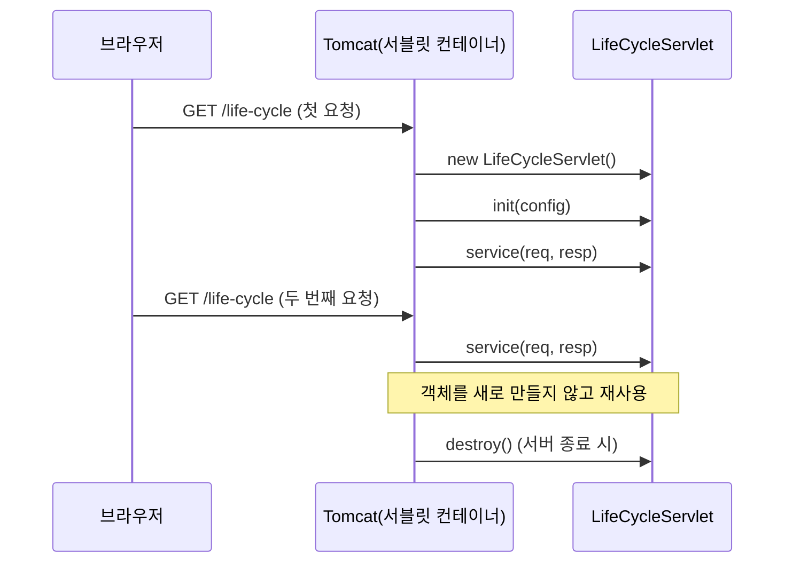
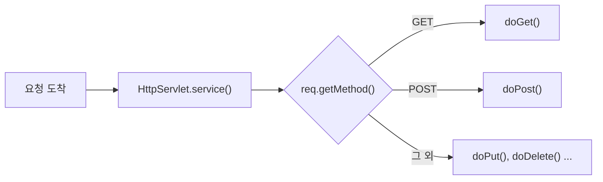

## 들어가며 (Situation)

지금까지 Java 코드는 전부 `main()`에서 시작했다. JDBC 실습도 콘솔에서 `Scanner`로 입력받아 DB를 조회하는 프로그램이었다. 이번 `06_Servlet` 강의부터는 **브라우저의 요청을 받아 처리하는 서버 쪽 코드**를 다룬다.

첫 프로젝트 `chap01-servlet`은 패키지 3개로 나뉘어 있고, `index.html`에서 각 실습으로 들어가는 구조다.

| 순서 | 패키지 | 서블릿 | URL | 확인한 것 |
|------|--------|--------|-----|-----------|
| 1 | `a_lifecycle` | `LifeCycleServlet` | `/life-cycle` | 서블릿 객체가 언제 만들어지고 메서드가 언제 호출되는지 |
| 2 | `b_service` | `ServiceMethodServlet` | `/request-service` | GET/POST 요청이 어떤 메서드로 들어오는지 |
| 3 | `c_parameter` | `QueryStringServlet`, `FormDataServlet` | `/querystring`, `/formdata` | 사용자가 보낸 값을 어떻게 꺼내는지 |

```java
// build.gradle (일부)
plugins {
    id 'java'
    id 'war'
}

dependencies {
    compileOnly('jakarta.servlet:jakarta.servlet-api:6.1.0')
}
```

`war` 플러그인으로 웹 애플리케이션으로 묶고, 서블릿 API는 `compileOnly`로 컴파일할 때만 쓴다. 실행할 때는 서버(Tomcat)가 API 구현체를 갖고 있기 때문이다.


## 문제 상황 (Task)

서블릿 코드를 처음 열었을 때 이상한 점이 많았다.

| 의문 | 코드에서 보인 것 |
|------|------------------|
| `main()`이 없는데 누가 객체를 만들고 메서드를 부르나? | 클래스에 `@WebServlet`만 붙어 있고 `new`하는 곳이 없음 |
| 요청이 GET인지 POST인지 어떻게 나누나? | `service()`를 쓴 버전과 `doGet()`/`doPost()`를 쓴 버전이 같이 있음 |
| 폼에 입력한 값은 어떻게 받나? | `parameter.html`의 폼은 6개 항목을 보내는데 서블릿은 그중 일부만 꺼냄 |
| URL 매핑은 어디서 하나? | `web.xml`이 비어 있음 |

정리하면, 이번 실습의 과제는 **"브라우저 요청 하나가 내 Java 메서드에 도착하기까지 무슨 일이 일어나는지"** 를 이해하는 것이었다.

## 해결 과정 (Action)

### 1. `@WebServlet` — URL과 클래스를 연결하기

`web.xml`을 열어보면 `<web-app>` 태그만 있고 내용이 없다.

```xml
<web-app xmlns="https://jakarta.ee/xml/ns/jakartaee"
         ...
         version="6.1">
</web-app>
```

예전에는 이 파일에 `<servlet>`, `<servlet-mapping>`으로 URL과 클래스를 하나하나 적었다고 한다. 이번 실습에서는 그 대신 클래스 위에 어노테이션을 붙였다.

```java
/* comment.
*   @WebServlet 어노테이션.
*   해당 클래스가 Servlet 임을 명시하는 어노테이션이다.
*   value 속성 해당 서블릿이 처리할 url 패턴을 명시한다.
*  */
@WebServlet(value = "/life-cycle")
public class LifeCycleServlet extends HttpServlet {
```

서버가 시작될 때 `@WebServlet`이 붙은 클래스를 찾아 URL 매핑 표를 만든다. 그래서 서블릿 4개를 만들었는데도 `web.xml`에 매핑을 한 줄도 쓰지 않았다.

### 2. 라이프사이클 — 객체는 한 번, `service()`는 요청마다

`LifeCycleServlet`은 생성자와 라이프사이클 메서드 3개에 출력문과 호출 횟수 카운터를 넣어둔 클래스다.

```java
private int initCount = 1;
private int serviceCount = 1;
private int destroyCount = 1;

public LifeCycleServlet() {
    System.out.println("기본생성자 호출됨...");
}

@Override
public void init(ServletConfig config) throws ServletException {
    System.out.println("init() 호출됨... : " + initCount++);
}

@Override
protected void service(HttpServletRequest req, HttpServletResponse resp) throws ServletException, IOException {
    System.out.println("service() 호출됨... : " + serviceCount++);
}

@Override
public void destroy() {
    System.out.println("destory() 호출됨... : " + destroyCount++);
}
```

카운터를 **인스턴스 필드**로 둔 게 핵심이다. 요청마다 새 객체가 만들어진다면 카운터는 매번 1부터 다시 시작해야 한다. 반대로 숫자가 계속 올라간다면 같은 객체가 계속 쓰이고 있다는 뜻이 된다.

`/life-cycle`에 여러 번 접속하고 서버를 끄면, 스펙대로라면 콘솔에는 아래처럼 찍힌다.


```text
기본생성자 호출됨...
init() 호출됨... : 1
service() 호출됨... : 1
service() 호출됨... : 2
service() 호출됨... : 3
destory() 호출됨... : 1
```



| 메서드 | 호출 시점 | 호출 횟수 |
|--------|-----------|-----------|
| 생성자 | 첫 요청 때 (또는 설정에 따라 서버 시작 때) | 1번 |
| `init()` | 생성 직후 | 1번 |
| `service()` | 요청이 올 때마다 | 요청 수만큼 |
| `destroy()` | 서버 종료·재배포 때 | 1번 |

Servlet 스펙도 분산 환경이 아니면 **서블릿 선언 하나당 인스턴스 하나만** 쓴다고 정해두고 있다. `main()`이 없던 이유가 여기서 풀렸다. 객체를 만들고 메서드를 부르는 일은 내가 아니라 **컨테이너(Tomcat)** 가 한다.

#### 다시 보니 고칠 점: `init(ServletConfig)` 재정의

공식 문서를 찾아보다가 실습 코드에서 놓친 부분을 발견했다. `GenericServlet`의 `init(ServletConfig)` 문서에는 이렇게 적혀 있다.

> This implementation stores the ServletConfig object it receives from the servlet container for later use. When overriding this form of the method, call `super.init(config)`.
> — [Jakarta Servlet API - GenericServlet](https://jakarta.ee/specifications/servlet/6.0/apidocs/jakarta.servlet/jakarta/servlet/GenericServlet.html)

실습 코드는 `super.init(config)`를 부르지 않는다. 이러면 부모가 `config`를 저장하지 못해서, 나중에 `getServletConfig()`나 `getInitParameter()`를 쓸 때 값을 얻을 수 없다. 지금은 출력만 해서 문제가 드러나지 않았을 뿐이다. 문서는 매개변수 없는 `init()`을 재정의하면 `super` 호출을 신경 쓰지 않아도 된다고 안내한다.

```java
// 예시 코드 — 초기화 로직만 필요하면 매개변수 없는 init()을 재정의
@Override
public void init() throws ServletException {
    System.out.println("init() 호출됨... : " + initCount++);
}
```

### 3. `service()` 대신 `doGet()` / `doPost()`

`ServiceMethodServlet`에는 **주석 처리된 첫 번째 시도**가 남아 있다.

```java
//    @Override
//    protected void service(HttpServletRequest req, HttpServletResponse resp) throws ServletException, IOException {
//
//        /* comment.
//        *   a 태그의 href 속성은 화면의 URL 을 변경하는 속성이다.
//        *   URL 이 변경되는 방식은 GET 방식의 요청에 해당한다.
//        *  */
//        System.out.println("req : " + req);
//        String httpMethod = req.getMethod();
//        System.out.println("httpMethod = " + httpMethod);
//
//    }
```

처음에는 `service()`를 직접 재정의해서 `req.getMethod()`로 요청 방식(GET/POST)을 출력해봤다. 이 방식이면 GET과 POST를 나누려면 `service()` 안에서 `if`로 직접 분기해야 한다.

그런데 `HttpServlet`의 `service()`가 이미 그 분기를 해준다. 그래서 `service()`를 주석 처리하고 `doGet()`, `doPost()`만 재정의했다.

```java
@Override
protected void doGet(HttpServletRequest req, HttpServletResponse resp) throws ServletException, IOException {
    System.out.println("GET 요청을 처리할 메소드 호출됨...");
}

@Override
protected void doPost(HttpServletRequest req, HttpServletResponse resp) throws ServletException, IOException {
    System.out.println("POST 요청을 처리할 메소드 호출됨...");
}
```



[HttpServlet 공식 문서](https://jakarta.ee/specifications/servlet/6.0/apidocs/jakarta.servlet/jakarta/servlet/http/HttpServlet.html)에도 같은 내용이 있다.

> There's almost no reason to override the service method.

주의할 점은 **`service()`를 재정의하면 이 분기가 사라진다**는 것이다. 주석을 풀어 두 방식을 같이 두면 내가 만든 `service()`가 부모 것을 덮어써서 `doGet()`/`doPost()`는 호출되지 않는다. 주석 처리한 게 맞는 선택이었다.

`service.html`에서는 같은 URL로 요청 방식만 바꿔 보내봤다.

| HTML 요소 | 요청 방식 | 호출된 메서드 |
|-----------|-----------|---------------|
| `<a href="/request-service">` | GET | `doGet()` |
| `<form method="get">` | GET | `doGet()` |
| `<form method="post">` | POST | `doPost()` |

`<a>` 태그 링크를 누르는 것도 GET 요청이라는 게 의외였다. 주소창에 URL을 치는 것과 똑같이 "이 주소의 페이지를 달라"는 요청이기 때문이다.

### 4. 요청 파라미터 꺼내기 — `getParameter()`

`parameter.html`은 같은 입력 폼을 GET용과 POST용으로 하나씩 갖고 있다. 폼이 보내는 항목과, 서블릿에서 실제로 꺼낸 항목을 비교해보면 이렇다.

| `name` 속성 | 입력 방식 | `QueryStringServlet` (GET) | `FormDataServlet` (POST) |
|-------------|-----------|:--:|:--:|
| `name` | text | O | O |
| `age` | number | O (`int`로 변환) | - |
| `birthday` | date | - | - |
| `gender` | radio | - | - |
| `national` | select | - | - |
| `hobbies` | checkbox (여러 개) | - | - |

GET 쪽 서블릿 코드:

```java
@WebServlet(value = "/querystring")
public class QueryStringServlet extends HttpServlet {

    @Override
    protected void doGet(HttpServletRequest req, HttpServletResponse resp) throws ServletException, IOException {

        String name = req.getParameter("name");
        System.out.println("name = " + name);

        /* comment.
            URL 로 전달되는 데이터는 모두 String 타입이다.
            따라서 원하는 자료형으로 담기 위해서는 파싱이 필요하다.
        */
        int age = Integer.parseInt(req.getParameter("age"));
        System.out.println("age = " + age);
    }
}
```

폼의 `name` 속성값이 그대로 `getParameter()`의 키가 된다. `<input type="number">`로 받았어도 서버에 도착하면 문자열이라 `Integer.parseInt()`로 변환해야 한다.

GET 요청은 폼 대신 `<a>` 태그에 값을 직접 붙여서 보낼 수도 있다.

```html
<a href="/querystring?name=홍길동&age=20&birthday=2021-01-08&gender=M&national=ko&hobbies=movie&hobbies=music&hobbies=sleep">쿼리스트링을 이용한 값 전달</a>
```

`?` 뒤가 쿼리스트링이고, `키=값`을 `&`로 이어 붙인다. GET 폼을 제출해도 브라우저가 똑같은 모양의 URL을 만든다.

#### 다 꺼내지 못한 값들

이 URL을 보다가 `hobbies`가 3번 들어 있는 걸 봤다. 체크박스는 값이 여러 개일 수 있다. [ServletRequest 공식 문서](https://jakarta.ee/specifications/servlet/6.0/apidocs/jakarta.servlet/jakarta/servlet/ServletRequest.html)를 보면 `getParameter()`는 값이 하나일 때만 쓰라고 되어 있다.

> If you use this method with a multivalued parameter, the value returned is equal to the first value in the array returned by `getParameterValues`.

`getParameter("hobbies")`를 쓰면 `movie`만 나오고 나머지는 버려진다. 여러 값은 `getParameterValues()`로 배열로 받아야 한다.

```java
// 예시 코드 — 체크박스처럼 값이 여러 개인 파라미터
String[] hobbies = req.getParameterValues("hobbies");
System.out.println("hobbies = " + Arrays.toString(hobbies)); // [movie, music, sleep]
```

또 `getParameter()`는 그 이름의 파라미터가 아예 없으면 `null`을 돌려준다. 그래서 `age` 없이 `/querystring?name=홍길동`으로 요청하거나 나이 칸을 비워 폼을 보내면 `Integer.parseInt()`가 `NumberFormatException`을 던진다. 실습 코드는 값이 항상 들어온다고 가정하고 있다.


### 5. GET과 POST — 코드 주석을 공식 문서로 다시 확인하기

`FormDataServlet`에는 GET과 POST의 차이를 정리한 긴 주석이 있다.

```java
/* comment.
*   - GET 요청
*   URL에 데이터가 노출이 되며, 데이터의 크기도 한정된다.
*   ...
*   또한 대략 200자 내의 데이터만 전달할 수 있기 때문에
*   게시글 등을 Insert 하는 것에는 적합하지 않다.
*   다만, GET 은 속도가 빠르기 때문에 조회 시 많이 사용된다.
*   - POST 요청
*   데이터가 URL에 노출되지 않고 Payload(Body) 라고 불리는 영역에
*   데이터를 담아서 Server 에 전달한다.
*   ...
*   */
```

"200자"라는 숫자가 마음에 걸려서 HTTP 표준 문서(RFC 9110)를 찾아봤다.

| 주석 내용 | RFC 9110 기준 |
|-----------|---------------|
| GET은 URL에 데이터가 노출된다 | 맞다. 그래서 비밀번호 같은 값은 GET으로 보내면 안 된다 (주소창, 방문 기록, 서버 로그에 남는다) |
| GET은 대략 200자까지만 보낼 수 있다 | 표준이 정한 상한은 없다. 오히려 URI를 **최소 8000 옥텟**까지는 지원하라고 권장한다 ([§4.1](https://www.rfc-editor.org/rfc/rfc9110.html#section-4.1)). 실제 한도는 브라우저와 서버 설정마다 다르다 |
| POST는 Body에 데이터를 담는다 | 맞다. `FormDataServlet`의 URL은 `/formdata`뿐이고 값은 Body로 간다 |
| GET은 빨라서 조회에 쓴다 | 속도보다는 **의미** 차이다. GET은 "읽기 전용"인 안전한(safe) 메서드이고([§9.2.1](https://www.rfc-editor.org/rfc/rfc9110.html#section-9.2.1)), 응답을 캐시할 수 있다([§9.3.1](https://www.rfc-editor.org/rfc/rfc9110.html#section-9.3.1)) |

RFC 9110 §9.3.1은 GET 응답을 이렇게 설명한다.

> The response to a GET request is cacheable; a cache MAY use it to satisfy subsequent GET and HEAD requests

정리하면 "GET은 짧고 빠르니까 조회용"이 아니다. **서버 상태를 바꾸지 않는 조회는 GET, 데이터를 생성·변경하는 요청은 POST**로 고르는 게 기준이다. 게시글 등록에 GET이 안 맞는 진짜 이유는 길이 제한보다, GET이 "읽기만 하는 요청"이라는 약속을 깨기 때문이다.

## 결과 (Result)

`chap01-servlet`에서 만든 것을 숫자로 정리하면 이렇다.

| 항목 | 수치 |
|------|------|
| 서블릿 클래스 | 4개 (총 149줄) |
| 테스트용 HTML | 3개 (`index`, `service`, `parameter`) |
| `web.xml` URL 매핑 | **0줄** (전부 `@WebServlet`으로 대체) |
| `init()` 호출 횟수 | 요청 수와 상관없이 1번 |
| 서블릿이 받은 파라미터 | 폼이 보낸 6개 중 GET 2개, POST 1개 |

JDBC 콘솔 실습과 비교하면 프로그램의 시작점 자체가 바뀌었다.

| 비교 | JDBC 콘솔 실습 | 서블릿 실습 |
|------|----------------|-------------|
| 시작점 | 내가 작성한 `main()` | 컨테이너가 부르는 `service()` |
| 객체 생성 | 내가 `new` | 컨테이너가 첫 요청 때 1번 |
| 입력 | `Scanner` | `req.getParameter()` |
| 입력 타입 | `nextInt()` 등으로 바로 받음 | 항상 `String` → 직접 변환 |

**배운 점**

- 서블릿은 내가 실행하는 프로그램이 아니라 **컨테이너가 필요할 때 호출하는 부품**이다. 그래서 `main()`이 없다.
- `service()`는 직접 재정의하지 말고 `doGet()`/`doPost()`만 재정의한다. 실습 코드에 주석으로 남은 첫 시도가 그 이유를 보여준다.
- 강의 주석도 그대로 믿지 않고 공식 문서와 대조해보니, `init(ServletConfig)` 재정의와 GET 길이 제한에서 바로잡을 부분이 나왔다.


## 더 학습하면 좋은 개념

- **서블릿의 스레드 안전성** — 서블릿 객체는 하나인데 요청은 동시에 여러 개 들어온다. `serviceCount++` 같은 인스턴스 필드 수정은 동시 요청에서 값이 꼬일 수 있다. 서블릿에 상태를 두면 안 되는 이유를 이해하면 이후 Spring의 싱글톤 빈도 같은 원리로 이해된다.
- **요청·응답 문자 인코딩 (`setCharacterEncoding`)** — POST Body로 오는 한글이 깨지는 문제와 연결된다. 서버가 어떤 인코딩으로 Body를 읽는지 알아두면 나중에 필터로 한 번에 처리하는 이유가 보인다.
- **응답 보내기 (`HttpServletResponse`)** — 이번 실습은 콘솔 출력만 했다. 브라우저에 실제 결과를 돌려주는 방법(`getWriter()`, `setContentType()`)이 다음 단계다.
- **forward와 redirect** — 서블릿끼리, 또는 서블릿에서 JSP로 요청을 넘기는 두 방식이다. 요청이 하나로 이어지는지 새로 생기는지가 다르다.
- **`ServletConfig`와 `ServletContext`** — `init(config)`로 받는 설정 객체와, 애플리케이션 전체가 공유하는 객체다. `super.init(config)`가 왜 필요한지 더 정확히 이해할 수 있다.

## 참고 자료

- [Jakarta Servlet 6.1 Specification](https://jakarta.ee/specifications/servlet/6.1/jakarta-servlet-spec-6.1)
- [Jakarta Servlet API - HttpServlet](https://jakarta.ee/specifications/servlet/6.0/apidocs/jakarta.servlet/jakarta/servlet/http/HttpServlet.html)
- [Jakarta Servlet API - GenericServlet](https://jakarta.ee/specifications/servlet/6.0/apidocs/jakarta.servlet/jakarta/servlet/GenericServlet.html)
- [Jakarta Servlet API - ServletRequest](https://jakarta.ee/specifications/servlet/6.0/apidocs/jakarta.servlet/jakarta/servlet/ServletRequest.html)
- [RFC 9110 - HTTP Semantics](https://www.rfc-editor.org/rfc/rfc9110.html)
- [Jakarta EE Tutorial - Jakarta Servlet](https://jakarta.ee/learn/docs/jakartaee-tutorial/current/web/servlets/servlets.html)
