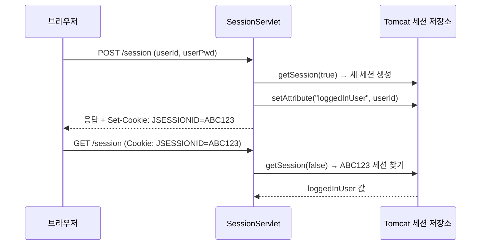
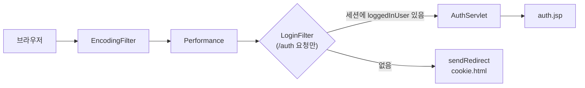
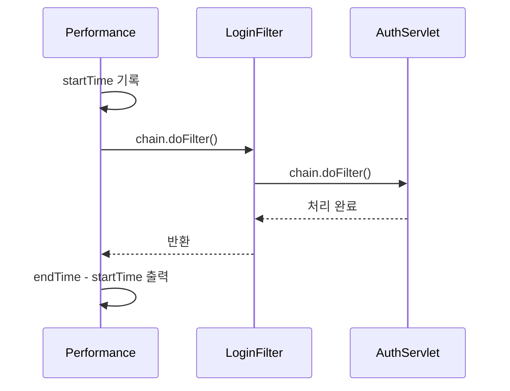

## 들어가며 (Situation)

[앞 글](2026-10-23-%EC%9D%91%EB%8B%B5%EC%9D%80-%EB%88%84%EA%B0%80-%ED%95%A0%EA%B9%8C-%EC%84%9C%EB%B8%94%EB%A6%BF-%EC%9D%91%EB%8B%B5%2C-%EC%97%90%EB%9F%AC-%ED%8E%98%EC%9D%B4%EC%A7%80%2C-forward%EC%99%80-redirect.html)에서 forward와 redirect를 비교하면서 `RedirectServlet`의 마지막 주석으로 끝냈다.

```java
/* comment.
    Redirect 는 이전 요청을 아예 모른다가 장점이자 단점이 된다.
    이 단점을 극복하기 위해 나온 개념이 Cookie/Session 이다.
    Coockie / Session 은 Redirect 를 하더라도 정보를 공유할 수 있게 해준다.
 */
```

`chap01-servlet`의 마지막 두 패키지가 그 이야기다.

| 순서 | 패키지 | 클래스 | 화면 | 확인한 것 |
|------|--------|--------|------|-----------|
| 8 | `h_cookie_session` | `CookieServlet`, `SessionServlet`, `ExpireServlet` | `cookie.html`, `cookie-result.jsp`, `session-result.jsp` | 요청이 바뀌어도 값을 기억하는 방법 |
| 9 | `i_filter` | `EncodingFilter`, `LoginFilter`, `Performance`, `AuthServlet` | `auth.jsp` | 서블릿 앞에서 공통 작업을 처리하는 방법 |

이번 실습부터 응답 화면이 `StringBuilder`가 아니라 **JSP**로 바뀌었다.

## 문제 상황 (Task)

| 문제 | 어디서 드러났나 |
|------|----------------|
| HTTP는 요청이 끝나면 이전 요청을 기억하지 못한다 | redirect하면 `req.setAttribute()`로 넣은 값이 사라짐 |
| 로그인 상태를 여러 페이지에서 유지해야 한다 | 로그인 후 다른 URL로 가면 누가 로그인했는지 모름 |
| 응답 서블릿마다 같은 줄이 반복된다 | `resp.setContentType("text/html; charset=UTF-8")`가 5개 서블릿에 반복 |
| 로그인 확인 코드도 페이지마다 넣어야 한다 | 로그인해야 볼 수 있는 페이지가 늘어날수록 같은 `if`가 늘어남 |

`ExceptionServlet`에는 이 반복을 직접 지적한 주석이 남아 있다.

```java
// 해당 코드는 응답시에 항상 해주어야 한글이 깨지지 않게 된다.
// == 계속 반복되는 코드
//resp.setContentType("text/html; charset=UTF-8");
```

정리하면 과제는 두 가지였다. **요청 사이에 정보를 유지하기**, 그리고 **모든 요청에 필요한 공통 작업을 한 곳에 모으기**.

## 해결 과정 (Action)

### 1. 쿠키 — 브라우저에 값을 맡기기

`cookie.html`의 첫 번째 폼은 입력값을 POST로 `/cookie`에 보낸다. `CookieServlet.doPost()`는 쿠키를 만들어 응답에 담는다.

```java
@Override
protected void doPost(HttpServletRequest req, HttpServletResponse resp) throws ServletException, IOException {
    // 쿠키에 담을 사용자의 입력값 추출(사용자가 입력했던 abc 는 req에 담겨있음)
    String cookieValue = req.getParameter("cookieValue");

    // 쿠키 객체 생성!
    Cookie cookie = new Cookie("userValue","cookieValue");
    // 쿠키 만료 시간 설정
    cookie.setMaxAge(60 * 60);      // 60초를 60번 반복한다. (60*60*24) => 1시간 * 24 = 하루

    // 우리가 만든 쿠키를 브라우저에게 응답(response) / 브라우저에게 보내줄 쿠키 add
    resp.addCookie(cookie);

    // 아래에 있는 메서드를 호출
    doGet(req,resp);        //포워드 방식임
}
```

`doGet()`은 요청에 실려 온 쿠키 중 `userValue`를 찾아 JSP로 forward한다.

```java
Cookie[] cookies = req.getCookies();
if(cookies != null) {
    for(Cookie cookie : cookies) {
        if("userValue".equals(cookie.getName())) {
            savedValue=cookie.getValue();
            break;
        }
    }
}

req.setAttribute("savedValue", savedValue);

RequestDispatcher rd = req.getRequestDispatcher(
        "/h_cookie_session/cookie-result.jsp"
);
rd.forward(req,resp);
```

[Cookie 공식 문서](https://jakarta.ee/specifications/servlet/6.0/apidocs/jakarta.servlet/jakarta/servlet/http/Cookie.html)에 따르면 `setMaxAge()`의 단위는 **초**다. `60 * 60`은 1시간이고, 음수면 브라우저를 닫을 때 지워지며, 0이면 바로 삭제된다.

```mermaid
sequenceDiagram
    participant B as 브라우저
    participant S as CookieServlet
    B->>S: POST /cookie (cookieValue=abc)
    S-->>B: 응답 + Set-Cookie: userValue=...; Max-Age=3600
    Note over B: 브라우저가 쿠키 저장
    B->>S: 다음 요청 (Cookie: userValue=...)
    S->>S: req.getCookies()로 읽기
```

#### 코드를 다시 보며 찾은 것 두 가지

**① 입력값이 아니라 문자열 `"cookieValue"`가 저장된다.**

```java
String cookieValue = req.getParameter("cookieValue");
Cookie cookie = new Cookie("userValue","cookieValue");   // 따옴표 때문에 변수가 아니라 글자 그대로
```

`cookieValue` 변수를 만들어 놓고 쓰지 않았다. 쿠키에는 무엇을 입력하든 `cookieValue`라는 글자가 들어간다.

```java
// 예시 코드 — 입력값을 쿠키에 담기
Cookie cookie = new Cookie("userValue", cookieValue);
```

**② 방금 만든 쿠키는 같은 요청에서 읽을 수 없다.** `resp.addCookie()`는 응답 헤더(`Set-Cookie`)에 쿠키를 싣는 것이고, `req.getCookies()`는 브라우저가 **이번 요청에 보낸** `Cookie` 헤더를 읽는다. `doPost()` 안에서 `doGet()`을 바로 부르면 아직 브라우저가 쿠키를 받기 전이다. 그래서 처음 제출하면 `없음!`이 나오고, 다시 제출해야 이전에 저장된 값이 보인다.


참고로 주석의 "포워드 방식임"은 정확히는 **같은 클래스의 메서드를 직접 호출**한 것이다. 실제 forward는 그다음 `doGet()` 안에서 JSP로 갈 때 일어난다. 앞 글 기준으로 보면 이 흐름은 POST 뒤에 forward라서 새로고침하면 POST가 재전송된다. POST에서 쿠키를 심은 뒤 `resp.sendRedirect("/cookie")`로 GET을 다시 부르면 ①과 ②가 함께 풀린다.

```java
// 예시 코드 — PRG: 쿠키 저장(POST) → redirect → 쿠키 읽기(GET)
resp.addCookie(new Cookie("userValue", cookieValue));
resp.sendRedirect("/cookie");
```

### 2. JSP와 EL — `StringBuilder`를 대신하는 응답 담당

forward 대상이 서블릿이 아니라 JSP가 됐다.

```jsp
<%@ page contentType="text/html;charset=UTF-8" language="java" %>
<html>
  <body>
       <h1> 쿠키에 저장 된 값 꺼내기! </h1>
       <h3> 쿠키에 저장 된 값 : ${savedValue} </h3>
  </body>
</html>
```

`${savedValue}`는 EL(Expression Language)로, `req.setAttribute("savedValue", ...)`로 넣은 값을 꺼낸다. 앞 글의 `ResponseLoginServlet`과 비교하면 차이가 크다.

| 비교 | 서블릿 + `StringBuilder` (`ResponseLoginServlet`) | JSP (`cookie-result.jsp`) |
|------|------|------|
| HTML 작성 | `.append("<h3>")` 한 줄씩 | HTML 그대로 |
| 값 넣기 | `.append(id)` | `${savedValue}` |
| 인코딩 설정 | `resp.setContentType(...)` | `<%@ page contentType=... %>` |
| 응답 출력 | `getWriter()` → `print` → `flush` → `close` | 없음 (컨테이너가 처리) |

`auth.jsp` 주석에는 이렇게 적었다.

```jsp
<%
    //JSP 파일은 HTML 처럼 보이지만 실제로는 Java 로 이루어진 Servlet 이다.
    // 태그는 내부에서 Java 소스코드를 입력할 수 있다.
    String user = (String) session.getAttribute("loggedInUser");
 %>
 <h3> <%= user %> </h3>
```

JSP는 처음 요청될 때 서블릿 클래스로 변환·컴파일된다. 결국 앞 글에서 손으로 하던 `append`를 컨테이너가 대신 만들어주는 셈이다. 이후 화면은 `<% %>` 스크립틀릿보다 `${}` EL을 쓰는 쪽이 일반적이다.

### 3. 세션 — 값은 서버에, 열쇠만 브라우저에

쿠키는 값이 브라우저에 그대로 저장된다. 비밀번호 같은 값을 맡기기엔 위험하다. 세션은 값을 **서버**에 두고, 브라우저에는 세션을 찾는 ID(`JSESSIONID` 쿠키)만 준다.



`getSession()`의 인자에 따라 동작이 다르다. 코드 주석과 [HttpServletRequest 공식 문서](https://jakarta.ee/specifications/servlet/6.0/apidocs/jakarta.servlet/jakarta/servlet/http/HttpServletRequest.html)가 같은 내용이다.

| 호출 | 세션이 있을 때 | 세션이 없을 때 | 쓴 곳 |
|------|---------------|---------------|------|
| `getSession(true)` / `getSession()` | 기존 세션 반환 | 새로 만들어 반환 | `SessionServlet.doPost()` (로그인) |
| `getSession(false)` | 기존 세션 반환 | `null` | `doGet()`, `ExpireServlet`, `LoginFilter` (확인만) |

로그인할 때만 세션을 만들고, 확인할 때는 만들지 않는다. 확인하다가 빈 세션을 만들어버리면 "로그인 안 한 사람"도 세션을 갖게 되기 때문이다.

로그인 처리(`doPost`)의 핵심 부분이다.

```java
HttpSession session = req.getSession(true);
String existUser = (String) session.getAttribute("loggedInUser");   // null 문자열이 됨

if(existUser == null || existUser.equals(userId)) {
    session.setAttribute("loggedInUser", userId);
    if(userPwd != null && !userPwd.isEmpty()) {
        session.setAttribute("userPwd", userPwd);
    }
    session.setMaxInactiveInterval(30); // session 의 유효 기간 설정 30초!
}
```

`setMaxInactiveInterval(30)`도 단위가 초다. **마지막 요청 후 30초 동안 요청이 없으면** 세션이 만료된다. 만든 시점부터 30초가 아니라 "비활성 시간"이라는 점이 쿠키의 `setMaxAge()`와 다르다.

로그아웃은 `ExpireServlet`이 맡는다. 세션을 무효화하고 redirect한다.

```java
HttpSession session = req.getSession(false);
if(session != null) {
    session.invalidate();       //세션을 무효화 시키는 메서드
}
resp.sendRedirect("/session");
```

#### 시행착오: `.toString()` 대신 캐스트

`doPost()`에는 처음 쓴 코드가 주석으로 남아 있다.

```java
// String existUser = session.getAttribute("loggedInUser").toString();
/* comment. 위에 줄을 사용하면 오류나는 이유
    위에서 세션 객체 처음 만들고 getAttribute 를 하면 값이 null 인데, null.toString() 으로 하면
    .이 참조 연산이므로 nulll 포인트 exception 이 발생하게 된다. 따라서 이 위에 줄로 하면 500번대 에러가 발생함
 */
// null 발생 여부가 존재하는 변수를 형변환 시 메서드로 형변환 하는 것보다
// () : 캐스트 연산자 == 형변환 연산자를 사용하는 것이 훨씬 안정적이다.
String existUser = (String) session.getAttribute("loggedInUser");
```

새로 만든 세션에는 아무 속성도 없으니 `getAttribute()`가 `null`을 돌려주고, `null.toString()`에서 `NullPointerException`이 난다. 서블릿에서 처리되지 않은 예외는 500 에러가 된다. `(String)` 캐스트는 `null`을 그대로 `null`로 두기 때문에 안전하다.

| 방식 | 값이 `"user01"`일 때 | 값이 `null`일 때 |
|------|------|------|
| `getAttribute(...).toString()` | `"user01"` | `NullPointerException` |
| `(String) getAttribute(...)` | `"user01"` | `null` |
| `String.valueOf(getAttribute(...))` | `"user01"` | 문자열 `"null"` |

그런데 `doGet()`에는 아직 `.toString()`이 남아 있다.

```java
if(session != null) {
    loggedInUser = session.getAttribute("loggedInUser").toString();
    pwd = session.getAttribute("userPwd").toString();
}
```

"세션이 있으면 로그인한 것"이라고 가정한 코드다. 하지만 세션이 있어도 속성이 없을 수 있다. 예를 들어 JSP는 기본값이 `session="true"`라서 `cookie-result.jsp`를 거치기만 해도 세션이 생긴다. 쿠키 테스트를 먼저 하고 "세션 확인" 링크를 누르면 세션은 있는데 `loggedInUser`가 없어 같은 NPE가 날 수 있다. 비밀번호 없이 로그인한 경우의 `userPwd`도 마찬가지다. `doPost()`에서 고친 방식을 그대로 적용하면 된다.


```java
// 예시 코드 — doGet()에도 캐스트 적용
if(session != null) {
    loggedInUser = (String) session.getAttribute("loggedInUser");
    pwd = (String) session.getAttribute("userPwd");
}
```

그 밖에 `doPost()`의 `if`/`else` 두 블록은 내용이 똑같고, 바깥 조건 `userId != null && !userPwd.isEmpty()`가 거짓이면(비밀번호를 비우고 제출하면) 아무 응답도 하지 않는다. "다른 사용자가 로그인하면 어떻게 할지"를 나누려다 남은 흔적으로 보인다.

#### 쿠키 vs 세션

| 비교 | 쿠키 | 세션 |
|------|------|------|
| 값 저장 위치 | 브라우저 | 서버 (브라우저에는 `JSESSIONID`만) |
| 만드는 법 | `new Cookie(이름, 값)` + `resp.addCookie()` | `req.getSession(true)` |
| 값 넣기/꺼내기 | 생성자 / `req.getCookies()` 반복문 | `setAttribute()` / `getAttribute()` |
| 값 타입 | 문자열만 | 아무 객체 |
| 만료 | `setMaxAge(초)` — 생성 후 시간 | `setMaxInactiveInterval(초)` — 마지막 요청 후 시간 |
| 삭제 | `setMaxAge(0)` | `invalidate()` |
| 실습 용도 | 사용자가 입력한 값 기억 | 로그인 사용자 기억 |

### 4. 필터 — 서블릿 앞에서 먼저 처리하기

`LoginFilter` 주석에 필터의 위치가 정리되어 있다.

```java
/* comment.
    Filter 는 Http 요청이  Servlet 에 도달하기 전에 동작하는 생명주기를 갖는다.
    서블릿에게 도달하기 전에 동작함!!
    @WebFilter("필터가 동작하는 경로")
    괄호 안에 있는 경로가 들어왔을 때만 필터가 동작함
 */
```

실습에서 만든 필터는 3개이고, 등록 방식이 두 가지로 섞여 있다.

| 필터 | 등록 방식 | 적용 URL | 하는 일 |
|------|-----------|----------|---------|
| `EncodingFilter` | `web.xml` | `/*` | 응답 `Content-Type` 설정 |
| `Performance` | `@WebFilter("/*")` | `/*` | 요청 처리 시간 측정 |
| `LoginFilter` | `@WebFilter("/auth/*")` | `/auth/*` | 세션 없으면 로그인 화면으로 redirect |



#### 4-1. `EncodingFilter` — 반복되던 한 줄을 한 곳으로

5개 서블릿에서 주석 처리된 `setContentType(...)`이 여기 하나로 모였다.

```java
public class EncodingFilter implements Filter {

    private String encodingType;

    @Override
    public void init(FilterConfig filterConfig) throws ServletException {
        System.out.println("인코딩 필터의 init() 호출됨...");
        encodingType = filterConfig.getInitParameter("encoding-type");
    }

    @Override
    public void doFilter(ServletRequest request, ServletResponse response, FilterChain chain) throws IOException, ServletException {
        response.setContentType(encodingType);
        chain.doFilter(request, response);
    }
}
```

값은 코드에 박지 않고 `web.xml`의 `<init-param>`에서 받는다.

```xml
<filter>
    <filter-name>encoding</filter-name>
    <filter-class>com.wanted.servlet.i_filter.EncodingFilter</filter-class>
    <init-param>
        <param-name>encoding-type</param-name>
        <param-value>text/html; charset=UTF-8</param-value>
    </init-param>
</filter>

<filter-mapping>
    <filter-name>encoding</filter-name>
    <url-pattern>/*</url-pattern>
</filter-mapping>
```

`init()`은 서블릿처럼 필터가 만들어질 때 한 번만 불리고, `doFilter()`는 요청마다 불린다. 첫 글에서 본 서블릿 라이프사이클과 같은 구조다. `d_response`의 `ResponseServlet`이 `resp.getContentType()`을 출력하던 것도 이 필터를 거치면 `null`이 아니라 설정된 값이 찍히게 된다.

#### 4-2. `Performance` — `chain.doFilter()` 앞뒤

```java
long startTime = System.currentTimeMillis();

// 다음 서블릿 OR 필터 호출
chain.doFilter(request, response);  //서블릿이나 필터가 다 거치고 되돌아옴.

long endTime = System.currentTimeMillis();

System.out.println("[" + req.getRequestURI() + "의 최종 수행 시간 : " + (endTime-startTime) + "(ms)");
```

`chain.doFilter()`는 다음 필터(없으면 서블릿)를 부르는 **메서드 호출**이라, 서블릿까지 다 처리되면 다시 이 줄 아래로 돌아온다. 그래서 앞에 쓴 코드는 요청 전에, 뒤에 쓴 코드는 응답 후에 실행된다. 필터 하나로 요청과 응답을 모두 감쌀 수 있다.



매개변수가 `HttpServletRequest`가 아니라 `ServletRequest`인 이유도 주석으로 남겨뒀다.

```java
//HttpRequest 로 받으면 되는거 아니야?? -> 언젠가는 HTTP 보다 훨씬 좋은 것이
//생길 수 있음. 따라서 부모로 받아버리면 괜찮으니까. ServletRequest 로 작성.
```

`Filter` 인터페이스 자체가 HTTP에 묶이지 않게 설계되어 있다. 그래서 `getRequestURI()`, `getSession()`처럼 HTTP 전용 메서드를 쓰려면 `(HttpServletRequest) request`로 형변환해야 한다. `Performance`와 `LoginFilter` 둘 다 첫 줄에서 형변환하는 이유다.

#### 4-3. `LoginFilter` — 로그인 검사를 서블릿 밖으로

```java
HttpServletRequest req = (HttpServletRequest) request;
HttpServletResponse resp = (HttpServletResponse) response;

// 기존 세션 유무 확인!
HttpSession session = req.getSession(false);

if(session == null || session.getAttribute("loggedInUser") == null) {
    resp.sendRedirect("/h_cookie_session/cookie.html");
} else {
    // ⭕ 통과! 다음 필터 또는 목표 서블릿으로 요청을 넘깁니다.
    chain.doFilter(req, resp);
}
```

**`chain.doFilter()`를 부르지 않으면 요청은 서블릿에 도착하지 않는다.** 로그인 안 한 사용자는 `AuthServlet`에 가지 못하고 로그인 화면으로 redirect된다.

그 덕분에 `AuthServlet`은 세션 검사를 하지 않는다.

```java
HttpSession session = req.getSession(false);

// 기존에 로그인 유저 정보 세션에서 꺼내오기
String existUser = (String)session.getAttribute("loggedInUser");
session.setAttribute("loggedInUser", existUser);
```

`getSession(false)`는 `null`일 수 있는데 바로 `.getAttribute()`를 부른다. 필터가 앞에서 막아준다는 전제가 있어야 안전한 코드다. 필터 매핑이 빠지면 바로 NPE가 된다. 또 `auth.jsp`가 세션에서 직접 `loggedInUser`를 꺼내므로, 같은 값을 다시 `setAttribute()`하는 두 줄은 없어도 결과가 같다.

#### 필터 실행 순서

`EncodingFilter`는 `web.xml`, 나머지 둘은 어노테이션으로 등록했다. Servlet 스펙에서 필터 순서는 `web.xml`의 `<filter-mapping>` 선언 순서로 정해지고, **어노테이션(`@WebFilter`)만으로는 순서를 지정할 수 없다.** 순서가 중요하면(예: 인코딩을 다른 필터보다 먼저) `web.xml`에 매핑을 적어야 한다. EncodingFilter 주석에 "xml → 옛날 프로젝트 방식"이라고 적었지만, 순서 제어와 `<init-param>` 때문에 지금도 `web.xml`을 쓰는 이유가 있는 셈이다.

## 결과 (Result)

| 항목 | Before (앞 글까지) | After (이번 실습) |
|------|-------------------|-------------------|
| `setContentType(...)` | 5개 서블릿에 반복 | `EncodingFilter` 1곳 (5줄 → 1줄) |
| 응답 HTML 작성 | `StringBuilder` 서블릿 4개 | JSP 3개 (`cookie-result`, `session-result`, `auth`) |
| redirect 후 정보 | 사라짐 | 쿠키(3600초) / 세션(비활성 30초) 동안 유지 |
| 로그인 확인 코드 | 페이지마다 필요 | `LoginFilter` 1곳 (`/auth/*`) |
| 새로 만든 클래스 | - | 서블릿 4개 + 필터 3개 (총 360줄) |

`chap01-servlet` 전체로 보면 `web.xml`이 0줄에서 에러 페이지 2개 + 필터 1개로 늘었고, 서블릿 16개 · 필터 3개 · JSP 3개(실습용 `index.jsp` 제외)가 됐다.

**배운 점**

- HTTP는 요청끼리 서로를 모른다. 쿠키는 브라우저에, 세션은 서버에 값을 두고 `JSESSIONID`로 이어 붙여 그 공백을 메운다.
- `getSession(true)`는 만들 때만, 확인할 때는 `getSession(false)`. 세션이 있다고 속성이 있는 건 아니다.
- `null`일 수 있는 값에 `.`을 찍지 않는다. 내 코드 주석에 적은 이 원칙을 같은 클래스의 `doGet()`에는 아직 적용하지 못했다.
- 필터는 "서블릿 앞의 서블릿"이다. 모든 요청에 필요한 일(인코딩, 시간 측정, 로그인 검사)은 서블릿이 아니라 필터에 둔다.

## 더 학습하면 좋은 개념

- **쿠키 보안 속성 (`HttpOnly`, `Secure`, `SameSite`)** — `JSESSIONID`가 탈취되면 로그인이 통째로 넘어간다. 자바스크립트 접근 차단, HTTPS 전용, 다른 사이트 요청 차단 속성을 알아야 세션을 안전하게 쓸 수 있다.
- **세션 고정 공격과 `changeSessionId()`** — 로그인 성공 시 세션 ID를 바꿔야 하는 이유. `HttpServletRequest.changeSessionId()`가 이 용도로 있다.
- **`request-character-encoding` / `response-character-encoding`** — Servlet 4.0부터 `web.xml`에 기본 인코딩을 선언할 수 있다. 인코딩 필터 없이 같은 효과를 내는 방법이다.
- **`HttpFilter`** — `Filter`를 HTTP 전용으로 감싼 추상 클래스(Servlet 4.0+). 매번 하던 `(HttpServletRequest)` 형변환이 필요 없다.
- **Spring Security의 필터 체인** — `LoginFilter`처럼 필터로 인증을 처리하는 구조를 크게 확장한 것이다. 이번 실습의 `chain.doFilter()` 흐름이 그대로 이어진다.

## 참고 자료

- [Jakarta Servlet API - Cookie](https://jakarta.ee/specifications/servlet/6.0/apidocs/jakarta.servlet/jakarta/servlet/http/Cookie.html)
- [Jakarta Servlet API - HttpSession](https://jakarta.ee/specifications/servlet/6.0/apidocs/jakarta.servlet/jakarta/servlet/http/HttpSession.html)
- [Jakarta Servlet API - HttpServletRequest](https://jakarta.ee/specifications/servlet/6.0/apidocs/jakarta.servlet/jakarta/servlet/http/HttpServletRequest.html)
- [Jakarta Servlet API - Filter](https://jakarta.ee/specifications/servlet/6.0/apidocs/jakarta.servlet/jakarta/servlet/Filter.html)
- [Jakarta Servlet API - FilterChain](https://jakarta.ee/specifications/servlet/6.0/apidocs/jakarta.servlet/jakarta/servlet/FilterChain.html)
- [Jakarta Servlet 6.1 Specification](https://jakarta.ee/specifications/servlet/6.1/jakarta-servlet-spec-6.1)
- [Jakarta Expression Language](https://jakarta.ee/specifications/expression-language/)
- [MDN - HTTP 쿠키](https://developer.mozilla.org/ko/docs/Web/HTTP/Cookies)
