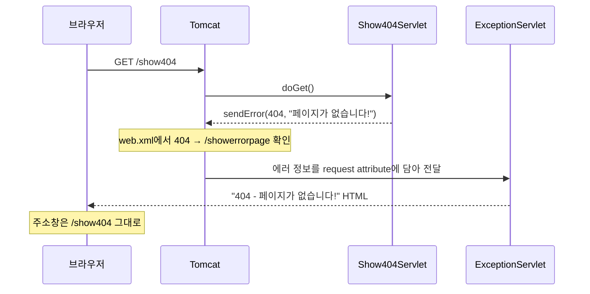
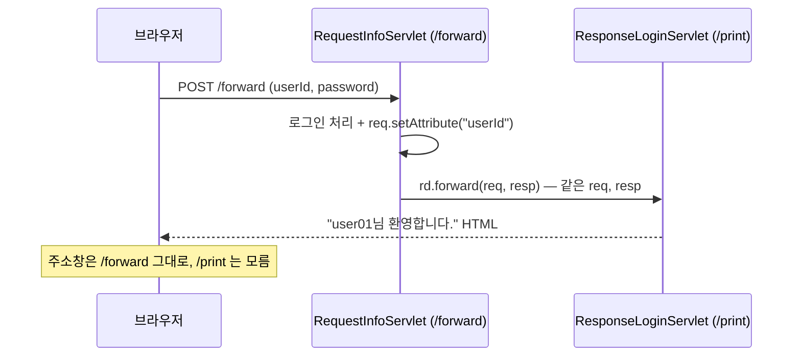
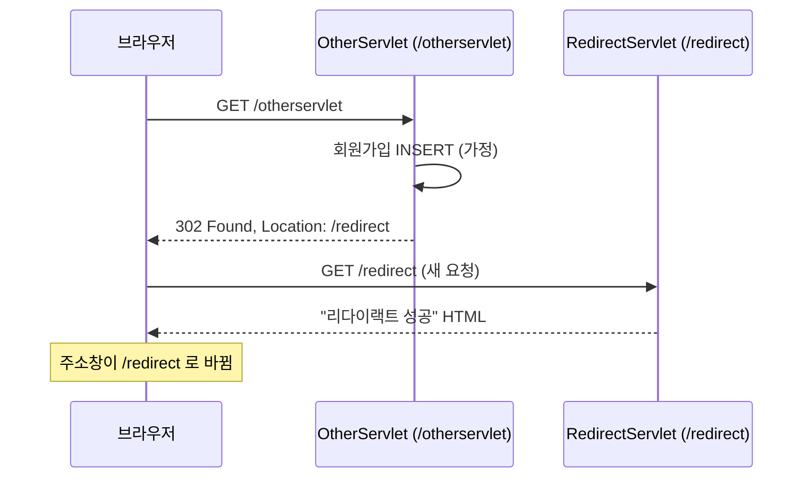
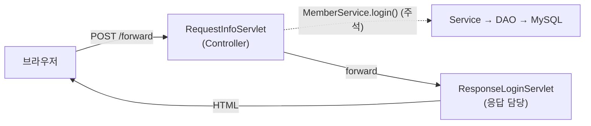

## 들어가며 (Situation)

[지난 글](2026-10-21-main%28%29-%EC%97%86%EB%8A%94-Java-%EC%BD%94%EB%93%9C%EB%8A%94-%EB%88%84%EA%B0%80-%EC%8B%A4%ED%96%89%ED%95%A0%EA%B9%8C-%EC%84%9C%EB%B8%94%EB%A6%BF-%EB%9D%BC%EC%9D%B4%ED%94%84%EC%82%AC%EC%9D%B4%ED%81%B4%EA%B3%BC-%EC%9A%94%EC%B2%AD-%ED%8C%8C%EB%9D%BC%EB%AF%B8%ED%84%B0.html)에서 `chap01-servlet`의 앞부분(`a_lifecycle` ~ `c_parameter`)을 정리했다. 그때까지 서블릿은 요청을 받아 **콘솔에 출력만** 했다. 브라우저에는 아무것도 돌려주지 않았다.

오늘 이어서 실습한 패키지는 이렇다.

| 순서 | 패키지 | 서블릿 | URL | 확인한 것 |
|------|--------|--------|-----|-----------|
| 4 | `d_response` | `ResponseServlet` | `/response` | 브라우저에 HTML 응답 보내기 |
| 5 | `e_exception` | `Show404Servlet`, `Show500Servlet`, `ExceptionServlet` | `/show404`, `/show500`, `/showerrorpage` | 에러가 났을 때 보여줄 페이지 등록 |
| 6 | `f_forward` | `RequestInfoServlet`, `ResponseLoginServlet` | `/forward`, `/print` | 응답을 다른 서블릿에 넘기기 (forward) |
| 7 | `g_redirect` | `OtherServlet`, `RedirectServlet` | `/otherservlet`, `/redirect` | 브라우저에게 다른 주소로 다시 요청하게 하기 (redirect) |

`ResponseServlet` 주석에 서블릿의 역할이 세 가지로 정리되어 있었는데, 이번 실습은 그중 3번을 다룬다.

```java
/* comment. Servlet 의 역할
    1. 요청 전달 받기
    - Http Method GET/POST 요청에 따라서
    - parameter 로 전달 받은 데이터를 꺼내올 수 있다.
    2. MVC 패턴 중 Controller 의 역할을 수행한다.
    - 전달 받은 데이터를 Service 계층에 전달하는 역할
    3. 응답 전달 하기
    - Response 객체를 활용해서 사용자에게 응답할 수 있다.
 */
```

## 문제 상황 (Task)

응답을 직접 만들기 시작하자 새로운 문제가 생겼다.

| 문제 | 코드에서 보인 것 |
|------|------------------|
| HTML을 Java 문자열로 만들어야 한다 | `StringBuilder`에 `.append("<html>")`를 줄줄이 이어 붙임 |
| 한글이 깨진다 | 응답마다 `setContentType("text/html; charset=UTF-8")`를 넣어야 함 |
| 에러가 나면 톰캣 기본 에러 화면이 뜬다 | `sendError(404, ...)`만으로는 내가 만든 화면이 안 나옴 |
| 한 서블릿이 너무 많은 일을 한다 | 로그인 처리 + 환영 HTML 만들기를 한 메서드에서 해야 함 |

특히 마지막 문제가 이번 실습의 중심이었다. `RequestInfoServlet` 주석에 이렇게 적혀 있다.

```java
/* comment. 해당 서블릿의 역할
    1. 사용자의 로그인 요청을 전달 받는다.
    2. 요청 객체에서 값을 꺼내어 로그인 처리를 진행한다.
    ---------------
    하지 않을 것
    1. 로그인 처리 완료 후 응답 HTML return (because -> 부하가 너무 큼)
 */
```

**요청을 처리하는 서블릿과 응답을 만드는 서블릿을 나누려면, 둘 사이에 요청을 어떻게 넘겨야 할까?** 그 답이 forward와 redirect였다.

## 해결 과정 (Action)

### 1. 응답 보내기 — `getWriter()`와 `StringBuilder`

`response.html`의 링크를 누르면 `/response`로 GET 요청이 가고, `ResponseServlet.doGet()`이 HTML을 만들어 돌려준다.

```java
StringBuilder response = new StringBuilder();
// append : 문자열을 추가한다.
response.append("<!doctype html>\n")
        .append("<html>\n")
        .append("<body>\n")
        .append("<h1>Servlet 의 응답 결과!</h1>")
        .append("</body>\n")
        .append("</html>\n");
System.out.println("response type : " + resp.getContentType());

// 한글이 깨지지 않게 보낼 타입을 설정해줌.
//resp.setContentType("text/html; charset=UTF-8");

//브라우저 화면에 노출 시키는 객체
PrintWriter out = resp.getWriter();
out.print(response);
out.flush();
out.close();
```

`req`와 `resp`의 성격 차이를 주석으로 정리해뒀다.

| 객체 | 용도 | 주로 쓰는 메서드 |
|------|------|------------------|
| `HttpServletRequest req` | 브라우저가 보낸 것을 **읽는다** | `getParameter()`, `getAttribute()`, `getMethod()` (getter 중심) |
| `HttpServletResponse resp` | 브라우저에 보낼 것을 **채운다** | `setContentType()`, `getWriter()`, `sendError()`, `sendRedirect()` (setter 중심) |

#### 한글이 깨지는 이유

`setContentType()`을 빼면 한글이 깨진다. [ServletResponse 공식 문서](https://jakarta.ee/specifications/servlet/6.0/apidocs/jakarta.servlet/jakarta/servlet/ServletResponse.html)의 `getCharacterEncoding()` 설명을 보면, 인코딩을 따로 지정하지 않았을 때 기본값은 `ISO-8859-1`이다. 한글이 없는 문자 집합이라 `getWriter()`로 쓴 한글이 `?`로 바뀐다.

그래서 `getWriter()`를 부르기 **전에** `setContentType("text/html; charset=UTF-8")`로 "HTML이고 UTF-8이다"를 알려줘야 한다. 순서가 중요하다. 문서에 따르면 `getWriter()`가 호출된 뒤에 바꾼 인코딩은 반영되지 않는다.

그런데 실습 코드에서 이 줄은 **전부 주석 처리**되어 있다. 이유는 다음 글에서 다룰 필터 때문이다. 일단 이번 글에서는 "응답하는 서블릿마다 같은 줄이 반복된다"는 점만 기억해두었다.

### 2. 에러 페이지 — `sendError()` + `web.xml`

`Show404Servlet`, `Show500Servlet`은 에러를 일부러 발생시키는 서블릿이다.

```java
@WebServlet("/show404")
public class Show404Servlet extends HttpServlet {
    @Override
    protected void doGet(HttpServletRequest req, HttpServletResponse resp) throws ServletException, IOException {
        System.out.println("404 Servlet 호출됨...");
        // throw new Exception(); 에러 터진다는 가정

        resp.sendError(404, "페이지가 없습니다!");
    }
}
```

`sendError()`만 쓰면 톰캣이 만든 기본 에러 화면이 나온다. 내가 만든 화면을 보여주려면 `web.xml`에 **에러 코드별로 이동할 위치**를 등록한다. 지난 실습에서는 비어 있던 `web.xml`에 처음으로 내용이 생겼다.

```xml
<error-page>
    <error-code>404</error-code>
    <location>/showerrorpage</location>
</error-page>

<error-page>
    <error-code>500</error-code>
    <location>/showerrorpage</location>
</error-page>
```

404든 500이든 `/showerrorpage`(`ExceptionServlet`)로 가고, 여기서 에러 정보를 꺼내 화면을 만든다.

```java
String forwardUrl = req.getAttribute("jakarta.servlet.forward.request_uri").toString();
out.println("forwardUrl = " + forwardUrl);

// 사용자에게 html 로 응답/응답 시 에러코드, 메시지 전달
int statusCode = (int) req.getAttribute("jakarta.servlet.error.status_code");
String msg = req.getAttribute("jakarta.servlet.error.message").toString();
```



코드 주석에도 "해당 개념은 forward의 개념"이라고 적혀 있다. 브라우저가 다시 요청하는 게 아니라 **서버 안에서 요청을 넘기는 것**이라, 주소창은 `/show404` 그대로다.

`ExceptionServlet`이 꺼낸 속성 이름은 [RequestDispatcher 공식 문서](https://jakarta.ee/specifications/servlet/6.0/apidocs/jakarta.servlet/jakarta/servlet/RequestDispatcher.html)에 상수로 정의되어 있다.

| 속성 이름 | 상수 | 내용 |
|-----------|------|------|
| `jakarta.servlet.error.status_code` | `ERROR_STATUS_CODE` | 상태 코드 (`Integer`) |
| `jakarta.servlet.error.message` | `ERROR_MESSAGE` | `sendError()`에 넣은 메시지 |
| `jakarta.servlet.error.request_uri` | `ERROR_REQUEST_URI` | 에러가 난 원래 요청 URI |
| `jakarta.servlet.forward.request_uri` | `FORWARD_REQUEST_URI` | forward 전 원래 요청 URI |

실습 코드는 원래 URI를 `forward.request_uri`로 꺼냈다. 그런데 에러 페이지용으로 스펙이 정해둔 이름은 `error.request_uri`다. forward 속성은 컨테이너가 에러 페이지를 어떤 방식으로 넘기느냐에 따라 없을 수 있고, 없으면 `.toString()`에서 `NullPointerException`이 난다. 에러 페이지에서 또 에러가 나는 셈이다.

```java
// 예시 코드 — 에러 페이지에서는 스펙이 정한 error 속성 사용
String errorUri = (String) req.getAttribute(RequestDispatcher.ERROR_REQUEST_URI);
```


### 3. forward — 서버 안에서 요청 넘기기

`forward.html`은 아이디·비밀번호를 POST로 `/forward`에 보낸다. `RequestInfoServlet`은 로그인 처리까지만 하고, 응답은 `/print`(`ResponseLoginServlet`)에 넘긴다.

```java
@Override
protected void doPost(HttpServletRequest req, HttpServletResponse resp) throws ServletException, IOException {
    String id=req.getParameter("userId");
    String pwd = req.getParameter("password");

    // 전달 받은 ID, PWD 를 Service -> DAO -> Mysql 로 전달
    // MemberService.login(id,pwd);     //요청 받은 후 비즈니스 로직 수행

    System.out.println("로그인 성공!!!");

    // 전달해줄 값 집어넣은 setter 메서드
    req.setAttribute("userId", id); //요청 객체에 다시 집어넣음
    // 다음 서블릿에게 보낼 요청을 탐색, dispatcher 는 어딘가로 뿌려줌.
    RequestDispatcher rd = req.getRequestDispatcher("/print");
    rd.forward(req,resp);
}
```

받는 쪽은 `getAttribute()`로 값을 꺼낸다.

```java
@WebServlet("/print")
public class ResponseLoginServlet extends HttpServlet {

    @Override
    protected void doPost(HttpServletRequest req, HttpServletResponse resp) throws ServletException, IOException {
    // 위임 요청했던 곳에서 doPost 였으므로 위임 요청을 받은 곳도 doPost 로 작성 해야함!!!
        String id = req.getAttribute("userId").toString();
        // ... "~님 환영합니다." HTML 응답
    }
}
```

여기서 두 가지를 확인했다.

**① `getParameter()`와 `getAttribute()`는 다르다.** 파라미터는 브라우저가 보낸 값이라 서버가 바꿀 수 없고 항상 `String`이다. 속성(attribute)은 서버 코드가 `setAttribute()`로 넣는 값이라 아무 객체나 담을 수 있다. forward 전에 `userId`를 속성으로 다시 넣은 이유다. (사실 같은 `req`를 넘기니 받는 쪽에서 `getParameter("userId")`로 꺼내도 된다. 속성은 서버에서 **가공한 결과**를 넘길 때 더 의미가 있다.)

**② 받는 서블릿은 `doPost()`를 재정의해야 한다.** forward는 같은 요청 객체를 그대로 넘기기 때문에 HTTP 메서드도 POST로 유지된다. `ResponseLoginServlet`에 `doGet()`만 있었다면 `HttpServlet`의 기본 `doPost()`가 불려 405 에러가 났을 것이다.



#### forward의 위험: 새로고침

`RequestInfoServlet` 끝에 "중요!"라고 표시된 주석이 있다.

```java
/* comment. 중요!
    1. forward 방식은 서로 다른 서블릿들이 req, resp 를 공유한다.
    2. forward 를 위임 받은 서블릿은 client 에게 존재가 노출되지 않는다.
    == url 의 변화가 없다.
    3. forward 방식의 특징은 새로고침 시 동일한 요청을 반복해서 DB에 insert, update, delete 하는
    행위가 발생할 수 있다.
    따라서 조회 시에는 forward 방식으로 진행하지만, DML 구문은 forward 방식으로 구현하면 큰일난다.
 */
```

브라우저 입장에서는 `POST /forward` 요청 하나만 보냈고 그 응답을 받았다. 새로고침은 **마지막 요청을 다시 보내는 것**이니 POST가 한 번 더 간다. 로그인이었다면 로그인을 다시 하고, 회원가입이었다면 INSERT가 한 번 더 실행된다.

### 4. redirect — 브라우저에게 다시 요청하라고 응답하기

이 문제를 피하는 방법이 redirect다. `OtherServlet`은 회원가입을 처리했다고 가정하고 `sendRedirect()`를 부른다.

```java
@WebServlet("/otherservlet")
public class OtherServlet extends HttpServlet {
    @Override
    protected void doGet(HttpServletRequest req, HttpServletResponse resp) throws ServletException, IOException {
        //memberService.signUp();        이 코드가 마무리 되면 회원가입이 된다고 가정!!
        System.out.println("회원정보 DB 에 Insert 완료!");

        resp.sendRedirect("/redirect");
    }
}
```

[HttpServletResponse 공식 문서](https://jakarta.ee/specifications/servlet/6.0/apidocs/jakarta.servlet/jakarta/servlet/http/HttpServletResponse.html)에 따르면 `sendRedirect()`는 상태 코드 `302 Found`와 `Location` 헤더를 담은 응답을 보낸다. 서버가 직접 `/redirect`를 부르는 게 아니라, **브라우저에게 "이 주소로 다시 가라"고 답하는 것**이다.



그래서 `RedirectServlet`은 `doGet()`만 있다. 주석에도 "URL 변경은 곧 a 태그를 누르는 것과 마찬가지의 효과를 가지기 때문에 get 방식이다"라고 적었다. 새로고침하면 `GET /redirect`만 반복되고, 회원가입 INSERT는 다시 실행되지 않는다.

#### 실습 코드를 다시 보며 든 생각

- **회원가입을 GET으로 했다.** `redirect.html`이 `<a>` 링크로 `/otherservlet`을 부르니 `OtherServlet`도 `doGet()`이다. 실습이라 간단히 한 것이지만, 지난 글에서 정리했듯 데이터를 바꾸는 요청은 POST가 맞다. 실제로는 **POST로 처리 → redirect → GET으로 결과 화면**의 순서가 된다. 이 패턴을 PRG(Post/Redirect/Get)라고 부른다.
- **경로가 `/`로 시작한다.** `sendRedirect("/redirect")`는 서버 루트 기준 경로다. 지금은 애플리케이션이 루트(`/`)에 배포되어 있어 문제없지만, 컨텍스트 경로가 생기면(예: `/chap01`) `req.getContextPath() + "/redirect"`처럼 붙여줘야 한다. 반면 `getRequestDispatcher("/print")`의 `/`는 애플리케이션 기준이라 그대로 둬도 된다.

### 5. forward vs redirect 정리

| 비교 | forward | redirect |
|------|---------|----------|
| 호출 | `req.getRequestDispatcher(경로).forward(req, resp)` | `resp.sendRedirect(경로)` |
| 누가 이동하나 | 서버 안에서 이동 | 브라우저가 새로 요청 |
| 요청 수 | 1번 | 2번 (302 응답 + 재요청) |
| 주소창 | 처음 요청한 URL 그대로 | 이동한 URL로 바뀜 |
| `req` 공유 | 공유 (`setAttribute` 값 전달 가능) | 새 요청이라 이전 값 사라짐 |
| HTTP 메서드 | 원래 요청 그대로 (POST면 POST) | GET으로 재요청 |
| 새로고침 시 | 원래 요청 반복 (POST면 재전송) | 이동한 GET 요청만 반복 |
| 어울리는 곳 | 조회 결과 보여주기 | INSERT/UPDATE/DELETE 후 결과 화면 |

`RedirectServlet` 마지막 주석이 다음 실습으로 이어진다.

```java
/* comment.
    Redirect 는 이전 요청을 아예 모른다가 장점이자 단점이 된다.
    이 단점을 극복하기 위해 나온 개념이 Cookie/Session 이다.
 */
```

## 결과 (Result)

| 항목 | 수치 |
|------|------|
| 새로 만든 서블릿 | 8개 (`d_response` ~ `g_redirect`, 총 373줄) |
| `StringBuilder`로 HTML을 만든 서블릿 | 4개 (`Response`, `Exception`, `ResponseLogin`, `Redirect`) |
| 같은 `setContentType(...)` 줄이 반복된 서블릿 | 4개 (모두 주석 처리 → 다음 글의 필터로 대체) |
| `web.xml`에 추가한 에러 페이지 | 2개 (404, 500 → 한 서블릿이 담당) |
| forward 요청 수 / redirect 요청 수 | 1번 / 2번 |

로그인 실습은 forward로 **처리 서블릿(로그인 로직)과 응답 서블릿(HTML)을 분리**했다. 주석에 적은 "`MemberService.login(id,pwd)`"까지 연결하면 지난 JDBC 실습의 Service → DAO 구조 앞에 서블릿이 Controller로 붙는 모양이 된다.



**배운 점**

- 응답을 서버 안에서 넘기면 forward, 브라우저에게 다시 요청시키면 redirect다. 주소창이 바뀌는지 보면 구분된다.
- 데이터를 바꾸는 요청 뒤에는 redirect를 쓴다. 새로고침이 INSERT를 다시 실행하지 않게 하기 위해서다.
- 에러 페이지 처리도 결국 컨테이너가 해주는 forward다. 그래서 주소창이 바뀌지 않는다.
- HTML을 `StringBuilder`로 만드는 건 4개 서블릿만 해도 반복이 많았다. 응답을 "잘하는" 다른 도구가 필요하다는 게 보였다.

## 더 학습하면 좋은 개념

- **PRG 패턴 (Post/Redirect/Get)** — 이번 글의 forward 새로고침 문제를 해결하는 표준 패턴이다. 폼 제출이 있는 모든 화면에 적용된다.
- **HTTP 상태 코드 301, 302, 303, 307** — `sendRedirect()`의 302 외에도 리다이렉트 코드가 여러 개 있다. 303과 307은 메서드를 GET으로 바꾸는지 유지하는지가 명확히 정해져 있다.
- **JSP와 EL** — `StringBuilder`로 HTML을 만드는 반복을 없애는 도구. 다음 실습에서 forward 대상이 서블릿에서 JSP로 바뀐다.
- **MVC 패턴** — 처리(Controller)와 화면(View)을 나눈 이번 forward 구조가 MVC의 기본 모양이다. Spring MVC의 `DispatcherServlet`도 같은 원리다.
- **`include`** — `RequestDispatcher`에는 `forward()` 말고 `include()`도 있다. 다른 서블릿의 결과를 내 응답 중간에 끼워 넣는 방식이다.

## 참고 자료

- [Jakarta Servlet API - ServletResponse](https://jakarta.ee/specifications/servlet/6.0/apidocs/jakarta.servlet/jakarta/servlet/ServletResponse.html)
- [Jakarta Servlet API - HttpServletResponse](https://jakarta.ee/specifications/servlet/6.0/apidocs/jakarta.servlet/jakarta/servlet/http/HttpServletResponse.html)
- [Jakarta Servlet API - RequestDispatcher](https://jakarta.ee/specifications/servlet/6.0/apidocs/jakarta.servlet/jakarta/servlet/RequestDispatcher.html)
- [Jakarta Servlet 6.1 Specification](https://jakarta.ee/specifications/servlet/6.1/jakarta-servlet-spec-6.1)
- [RFC 9110 - 15.4.3 302 Found](https://www.rfc-editor.org/rfc/rfc9110.html#section-15.4.3)
