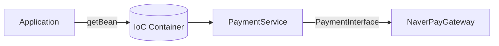
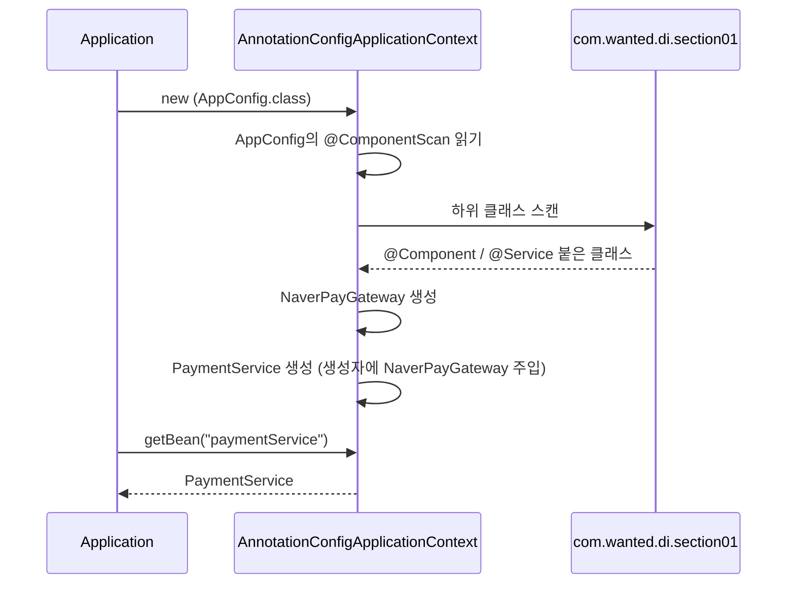
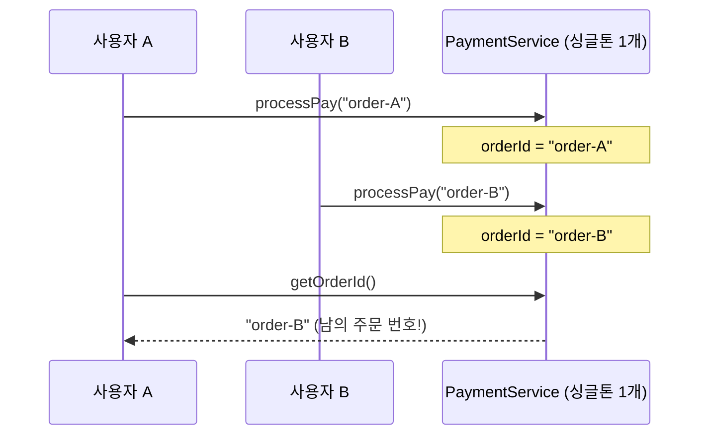

## 들어가며 (Situation)

07_Spring-Core 강의의 `chap02-dependency-injection`을 실습했다. 이번 챕터는 두 섹션으로 나뉘어 있어서 글도 두 편으로 나눴다.

| 순서 | 패키지 | 다룬 것 | 글 |
|------|--------|---------|-----|
| 1 | `section01` | `@ComponentScan`으로 Bean 자동 등록 | 이 글 |
| 2 | `section02` | 필드 / setter / 생성자 주입 비교 | 다음 글 |

실습 도메인은 chap01과 같은 **결제**다. `PaymentService`가 결제 비즈니스 로직을 맡고, 실제 결제는 `PaymentInterface`를 구현한 `NaverPayGateway`가 한다.



의존성은 `build.gradle`에 `spring-context` 하나만 추가했다. Spring Boot 없이 순수 Spring Framework로 실습한다.

```groovy
/* spring-context : Spring 프레임 워크의 핵심 의존성. IoC Container 생성 */
implementation 'org.springframework:spring-context:7.0.8'
```

## 문제 상황 (Task)

chap01에서는 설정 클래스(`AppConfig`)에 등록할 객체를 `@Bean` 메서드로 하나하나 적었다.

```java
@Configuration
public class AppConfig {

    @Bean
    public KakaoPayGateway kakaoPayGateway() {
        return new KakaoPayGateway();
    }

    @Bean
    public NaverPayGateway naverPayGateway() {
        return new NaverPayGateway();
    }

    @Bean("single")
    @Scope("singleton")
    public PaymentService paymentService() {
        return new PaymentService(naverPayGateway());
    }
    // ...
}
```

클래스 3개를 등록하는 데 메서드 4개가 필요했고, `PaymentService`에 어떤 Gateway를 넣을지도 내가 직접 `naverPayGateway()`를 호출해서 연결했다. section01 `Application`의 첫 주석이 바로 이 문제를 던진다.

```java
/* comment.
*   AppConfig 파일 하위에 Bean 들을 정의해서
*   IoC 컨테이너에 등록 했었다.
*   ---
*   문제 제기! : 만약 Bean 이 100개 라면?
*  */
```

| 문제 | 이유 |
|------|------|
| 설정 클래스가 계속 길어진다 | 클래스 하나당 `@Bean` 메서드 하나 |
| 연결도 직접 해야 한다 | `new PaymentService(naverPayGateway())`처럼 생성자 인자를 내가 채움 |
| 클래스를 추가할 때마다 두 곳을 고쳐야 한다 | 클래스 파일 + `AppConfig` |

**등록할 클래스가 스스로 "나를 Bean으로 등록해줘"라고 표시하고, 컨테이너가 그걸 찾아가게 할 수는 없을까?**

## 해결 과정 (Action)

### 1. 클래스에 표시하기: `@Component`와 `@Service`

먼저 Bean으로 등록할 클래스에 어노테이션을 붙였다. Gateway에는 `@Component`를 붙였다.

```java
@Component
public class NaverPayGateway implements PaymentInterface {

    @Override
    public boolean processPay(String orderId, int amount) {
        System.out.println("네이버페이로 결제 시작! : 주문 ID = " + orderId + ", 수량 = " + amount);
        return true;
    }
}
```

`PaymentService`에는 `@Service`를 붙였다.

```java
/* comment.
*   @Service 어노테이션은 @Component 의
*   특수한 형태이다.
*   MVC 패턴 중 Service 계층에 해당하는 Bean에
*   붙이게 된다.
*  */
@Service
public class PaymentService {

    private final PaymentInterface paymentInterface;

    public PaymentService(PaymentInterface paymentInterface) {
        this.paymentInterface = paymentInterface;
    }
    // ...
}
```

`@Service`는 내부적으로 `@Component`가 붙어 있는 어노테이션이라 스캔 대상이 되는 건 똑같다. 공식 문서는 이런 어노테이션들을 **스테레오타입(stereotype) 어노테이션**이라고 부른다.

| 어노테이션 | 붙이는 곳 | 비고 |
|-----------|-----------|------|
| `@Component` | 범용 컴포넌트 | 이번 실습의 `NaverPayGateway`, `Test` |
| `@Service` | 서비스 계층 | 이번 실습의 `PaymentService` |
| `@Repository` | 데이터 접근 계층 | 영속성 예외 변환 기능이 추가된다 |
| `@Controller` | 웹 계층 | Spring MVC에서 사용 |

> `@Repository`, `@Service`, and `@Controller` are specializations of `@Component` for more specific use cases (in the persistence, service, and presentation layers, respectively).
> — [Spring Framework Reference: Classpath Scanning and Managed Components](https://docs.spring.io/spring-framework/reference/core/beans/classpath-scanning.html)

여기서 눈여겨본 건 `PaymentService`의 생성자다. chap01에서는 내가 `naverPayGateway()`를 넣어줬지만, 이제는 `AppConfig`에 그런 코드가 없다. 그런데도 실행하면 네이버페이 결제가 정상 출력된다. 컨테이너가 `PaymentInterface` 타입 Bean(`NaverPayGateway`)을 찾아서 생성자에 넣어준 것이다. 이게 다음 글의 주제인 **의존성 주입**이다.

### 2. 찾아가게 하기: `@ComponentScan`

표시만 해서는 아무 일도 일어나지 않는다. 컨테이너에게 "어디를 뒤져라"라고 알려줘야 한다. `AppConfig`가 이렇게 바뀌었다.

```java
@Configuration
@ComponentScan(basePackages = "com.wanted.di.section01" ,
    excludeFilters = @ComponentScan.Filter(
            // ...
    )
)
//@ComponentScan
public class AppConfig {

}
```

`@Bean` 메서드가 전부 사라지고 **클래스 몸통이 비었다.** Bean이 100개가 되어도 `AppConfig`는 이 상태 그대로다.

컨테이너를 만드는 `Application` 코드는 chap01과 같다.

```java
// IoC Container 생성
// IoC Container == Application Context == Bean Factory
ApplicationContext context =
        new AnnotationConfigApplicationContext(AppConfig.class);

PaymentService pay = context.getBean("paymentService", PaymentService.class);
pay.processPay("order-003", 3);
```

`@Bean`에서는 메서드 이름이 Bean 이름이었는데, 스캔으로 등록하면 이름을 어디서 가져올까? `getBean("paymentService", ...)`로 꺼낸 걸 보면 **클래스 이름의 첫 글자를 소문자로 바꾼 것**이 기본 이름이다. (`PaymentService` → `paymentService`) 다음 글에서는 `@Service("field")`처럼 이름을 직접 지정해본다.

전체 흐름을 그려보면 이렇다.



### 3. 스캔 범위: `basePackages`

`AppConfig`에는 `//@ComponentScan`처럼 속성 없는 버전이 주석으로 남아 있다. 강의 주석에는 차이가 이렇게 적혀 있었다.

```java
/* comment.
*   basePackages 지정을 하지 않으면
*   스캔의 범위가 @ComponentScan 달려있는 클래스와
*   동일한 레벨(같은 패키지)까지만 스캔이 가능하다.
*  */
```

`AppConfig`는 `section01.config` 패키지에 있고, 등록하려는 클래스는 `section01.gateway`, `section01.service`에 있다. `basePackages` 없이 스캔하면 `config` 패키지 기준으로만 찾으므로 `gateway`와 `service`는 범위 밖이다. 그래서 `basePackages = "com.wanted.di.section01"`로 한 단계 위를 지정했다.

```text
com.wanted.di.section01          ← basePackages로 지정한 시작점
├── Application
├── config                       ← basePackages 없으면 여기서 시작
│   ├── AppConfig
│   └── Test (@Component)
├── gateway
│   └── NaverPayGateway (@Component)
└── service
    └── PaymentService (@Service)
```

다만 공식 Javadoc을 확인해보니 "같은 패키지까지만"보다는 **선언한 클래스의 패키지와 그 하위 패키지**가 기본 범위였다.

> If specific packages are not defined, scanning will occur from the package of the class that declares this annotation.
> — [ComponentScan Javadoc](https://docs.spring.io/spring-framework/docs/current/javadoc-api/org/springframework/context/annotation/ComponentScan.html)

`config` 아래에 하위 패키지가 없어서 실습에서는 결과가 같다. 하지만 이 규칙 때문에 Spring Boot에서는 `@SpringBootApplication` 클래스를 **최상위 패키지**에 두는 관례가 생겼다고 한다.

`config` 패키지 안에 있는 빈 클래스 `Test`도 `@Component`가 붙어 있으니 같이 등록된다. 스캔 범위 확인용으로 둔 클래스로 보인다.

<!-- TODO: Test 클래스를 둔 목적이 강의에서 따로 설명됐는지? (예: basePackages 없이 스캔했을 때 Test만 등록되는 것을 확인) 실제로 basePackages 없이 돌려서 NoSuchBeanDefinitionException 같은 에러를 봤다면 에러 메시지를 알려주세요. -->

### 4. 스캔에서 빼기: `excludeFilters`

반대로 범위 안에 있지만 등록하고 싶지 않은 클래스도 있다. `excludeFilters`에 세 가지 방법이 주석으로 남아 있었다. 하나씩 주석을 풀어가며 실습한 흔적이다.

```java
excludeFilters = @ComponentScan.Filter(
        // 1. 클래스명 제외
//            type = FilterType.ASSIGNABLE_TYPE, classes = {PaymentService.class}
        // 2. 어노테이션 제외
//            type = FilterType.ANNOTATION, classes = {org.springframework.stereotype.Service.class}
        // 3. 정규표현식 제외
//            type = FilterType.REGEX, pattern = {"com.wanted.di.section01.service.*"}
)
```

| `FilterType` | 기준 | 실습 코드에서 제외되는 것 |
|--------------|------|---------------------------|
| `ASSIGNABLE_TYPE` | 특정 클래스(와 그 하위 타입) | `PaymentService` |
| `ANNOTATION` | 특정 어노테이션이 붙은 클래스 | `@Service`가 붙은 클래스 = `PaymentService` |
| `REGEX` | 클래스 전체 이름 정규식 | `service` 패키지 아래 전부 = `PaymentService` |
| `ASPECTJ` | AspectJ 타입 패턴 | (실습 안 함) |
| `CUSTOM` | `TypeFilter` 직접 구현 | (실습 안 함) |

세 방법 모두 결과적으로 `PaymentService`를 빼는 예제다. 이 상태에서 `Application`을 실행하면 `getBean("paymentService", ...)`에서 해당 이름의 Bean을 찾지 못해 예외가 난다.

<!-- TODO: 필터를 켜고 실행했을 때 실제로 본 예외 메시지(NoSuchBeanDefinitionException 등)를 알려주세요. 없으면 이 문장을 "예외가 날 것이다"로 바꾸겠습니다. -->

같은 결과를 세 가지로 낼 수 있다면 언제 무엇을 쓸까? 내 생각은 이렇다.

- **한두 개 클래스만 뺄 때**는 `ASSIGNABLE_TYPE`이 가장 명확하다. 리팩터링으로 클래스 이름이 바뀌어도 컴파일러가 잡아준다.
- **계층 단위로 뺄 때**(예: 테스트에서 웹 계층 제외)는 `ANNOTATION`.
- `REGEX`는 문자열이라 패키지 이름이 바뀌면 조용히 안 맞게 된다. 실제로 section02의 `AppConfig`를 보면 정규식이 여전히 `"com.wanted.di.section01.service.*"`로 남아 있다. section01에서 복사해온 흔적인데, 주석을 풀었다면 section02에서는 아무것도 제외되지 않았을 것이다.

### 5. 주의: Bean은 싱글톤이다

`PaymentService`에는 일부러 넣은 듯한 필드가 하나 있다.

```java
private final PaymentInterface paymentInterface;
/* comment.
*   Bean 은 기본적으로 Singleton 이다.
*   가장 주의!!!!
*   - Bean 이 상태(필드) 값을 가지게 되면 모든 요청이
*   - 해당 필드 값을 공유하게 된다.
*   - 따라서 필드에는 행위 위주의 클래스(ex) service, dao) 만 작성하고
*   - 데이터 저장이 필요한 경우에는 각 요청별로 DTO 를 통해서 데이터를
*   - 저장한다.
*  */
private String orderId;

public boolean processPay(String orderId, int amount) {
    // ...
    this.orderId = orderId;
    // ...
}
```

`processPay`가 호출될 때마다 `this.orderId`를 덮어쓴다. 컨테이너 안에 `PaymentService`는 **하나뿐**이므로, 두 사용자가 동시에 결제하면 이런 일이 생길 수 있다.



그래서 정리하면 Bean의 필드에는 두 종류만 둔다.

| 필드에 둬도 되는 것 | 필드에 두면 안 되는 것 |
|--------------------|-----------------------|
| 다른 Bean (`PaymentInterface` 같은 의존 객체) | 요청마다 달라지는 값 (`orderId`, 금액, 사용자 정보) |
| 한 번 정해지면 안 바뀌는 설정값 | → 메서드 매개변수나 DTO로 전달 |

chap01에서 `@Scope("prototype")`을 배웠으니 "그럼 프로토타입으로 바꾸면 되지 않나?"라고 생각할 수 있다. 하지만 서비스처럼 행위를 담당하는 객체를 매 요청마다 새로 만드는 건 낭비이고, 상태를 빼는 게 근본적인 해결이다.

## 결과 (Result)

| 항목 | chap01 (`@Bean`) | chap02 section01 (`@ComponentScan`) |
|------|------------------|-------------------------------------|
| `AppConfig` 몸통 | `@Bean` 메서드 4개 | **비어 있음** |
| Bean 추가 시 수정할 곳 | 클래스 + `AppConfig` | 클래스에 어노테이션 1줄 |
| 의존 객체 연결 | `new PaymentService(naverPayGateway())` 직접 작성 | 컨테이너가 생성자에 자동 주입 |
| Bean 이름 | 메서드 이름 | 클래스 이름 첫 글자 소문자 |
| 등록 제외 | 메서드를 안 쓰면 됨 | `excludeFilters` (5가지 `FilterType`) |

배운 점

- `@Component`는 "등록해줘"라는 **표시**이고, `@ComponentScan`이 그 표시를 **찾는** 역할이다. 둘 중 하나만 있으면 아무 일도 안 일어난다.
- 스캔 범위는 기본적으로 설정 클래스의 패키지 기준이다. 그래서 설정 클래스 위치가 곧 스캔 범위를 결정한다.
- 정규식 필터는 패키지 이름이 바뀌면 조용히 틀어진다. section02로 복사된 정규식이 그 예였다.
- 싱글톤 Bean에 요청별 데이터를 필드로 두면 요청끼리 값을 공유한다. 편해진 만큼, 컨테이너가 객체를 **하나만** 만든다는 사실을 잊으면 안 된다.

[다음 글](2026-10-27-%40Autowired%EB%8A%94-%EC%96%B4%EB%94%94%EC%97%90-%EB%B6%99%EC%97%AC%EC%95%BC-%ED%95%A0%EA%B9%8C-%ED%95%84%EB%93%9C%2C-setter%2C-%EC%83%9D%EC%84%B1%EC%9E%90-%EC%A3%BC%EC%9E%85-%EB%B9%84%EA%B5%90.html)에서는 컨테이너가 `PaymentService`에 `NaverPayGateway`를 넣어준 방법, 즉 의존성 주입의 세 가지 방식을 비교한다.

## 더 학습하면 좋은 개념

- **`@Bean` vs `@Component`를 함께 쓰는 기준** — 내가 소스를 고칠 수 없는 외부 라이브러리 클래스는 `@Component`를 붙일 수 없으니 여전히 `@Bean`으로 등록한다. 두 방식이 언제 각각 쓰이는지 알아야 실무 설정 파일이 읽힌다.
- **Bean 이름 충돌과 `@Primary` / `@Qualifier`** — 지금은 `PaymentInterface` 구현체가 `NaverPayGateway` 하나뿐이라 자동 주입이 됐다. chap01처럼 `KakaoPayGateway`까지 `@Component`로 등록하면 어떤 걸 넣을지 컨테이너가 고를 수 없다.
- **`@SpringBootApplication`의 구성** — 내부에 `@ComponentScan`이 들어 있다. 이번에 배운 스캔 범위 규칙이 Spring Boot 프로젝트 구조를 어떻게 결정하는지 이어진다.
- **스레드 안전성(Thread Safety)** — 싱글톤 Bean 문제의 근본 원인. 서블릿도 인스턴스 하나를 여러 스레드가 공유한다는 점에서 같은 문제를 갖는다.
- **Bean Scope (`request`, `session`)** — 웹 환경에서는 싱글톤·프로토타입 외에 요청·세션 단위 스코프가 있다. 요청별 데이터를 다루는 또 다른 방법이다.

## 참고 자료

- [Spring Framework Reference - Classpath Scanning and Managed Components](https://docs.spring.io/spring-framework/reference/core/beans/classpath-scanning.html)
- [Spring Framework Javadoc - @ComponentScan](https://docs.spring.io/spring-framework/docs/current/javadoc-api/org/springframework/context/annotation/ComponentScan.html)
- [Spring Framework Javadoc - FilterType](https://docs.spring.io/spring-framework/docs/current/javadoc-api/org/springframework/context/annotation/FilterType.html)
- [Spring Framework Reference - Bean Scopes](https://docs.spring.io/spring-framework/reference/core/beans/factory-scopes.html)
