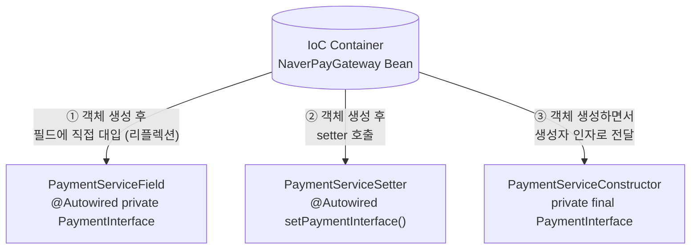

## 들어가며 (Situation)

[지난 글](2026-10-27-Bean%EC%9D%B4-100%EA%B0%9C%EB%9D%BC%EB%A9%B4-%40Bean-%EB%8C%80%EC%8B%A0-%40ComponentScan%EC%9C%BC%EB%A1%9C-%EC%9E%90%EB%8F%99-%EB%93%B1%EB%A1%9D%ED%95%98%EA%B8%B0.html)에서 `chap02-dependency-injection`의 `section01`을 정리했다. `@ComponentScan`으로 Bean을 자동 등록했더니, `PaymentService` 생성자에 `NaverPayGateway`를 아무도 넣어주지 않았는데도 결제가 잘 됐다.

이번 `section02`는 그 "넣어주는" 동작을 다룬다. `Application` 주석에 정의가 있다.

```java
/* comment.
*   DI : 의존성 주입
*   Spring 은 IoC 컨테이너 기능을 통해서
*   개발자가 직접 객체와 객체 간의 결합을 관리하는 것이 아닌,
*   IoC 컨테이너가 자동으로 객체 간의 의존성을 주입하는 것을
*   의미한다. == (new X)
*   ---
*   1. field 주입
*   2. setter 주입
*   3. constructor 주입
*  */
```

같은 결제 로직을 주입 방식만 바꿔서 세 클래스로 만들었다.

| 패키지 | 클래스 | Bean 이름 | 주입 위치 |
|--------|--------|-----------|-----------|
| `service.field` | `PaymentServiceField` | `"field"` | 필드 |
| `service.setter` | `PaymentServiceSetter` | `"setter"` | setter 메서드 |
| `service.constructor` | `PaymentServiceConstructor` | `"constructor"` | 생성자 |

세 클래스 모두 `@Service("이름")`으로 Bean 이름을 직접 지정했다. section01에서는 클래스 이름에서 자동으로 만들어진 `"paymentService"`로 꺼냈는데, 이번엔 지정한 이름으로 꺼낸다.

```java
ApplicationContext context =
        new AnnotationConfigApplicationContext(AppConfig.class);

PaymentServiceField pay = context.getBean("field", PaymentServiceField.class);
pay.processPay("order-003", 3);

System.out.println("=========================================================");

PaymentServiceSetter pay2 = context.getBean("setter", PaymentServiceSetter.class);
pay2.processPay("order-003", 3);
```

## 문제 상황 (Task)

세 방식 모두 실행 결과는 같다. "네이버페이로 결제 시작!"이 찍히고 "결제 성공!"이 나온다. 그럼 뭘 써도 되는 걸까?

결과가 같으니 차이는 **코드가 무엇을 허용하고 무엇을 막는지**에서 찾아야 했다. 비교 기준을 이렇게 잡았다.

| 기준 | 질문 |
|------|------|
| 불변성 | 주입된 의존 객체를 나중에 바꿀 수 있는가? (`final` 가능?) |
| 필수 보장 | 의존 객체 없이 객체가 만들어질 수 있는가? (`null` 가능?) |
| 실수 방지 | 누군가 `new`로 직접 대입하면 컴파일러가 막는가? |

## 해결 과정 (Action)

세 방식이 어디에 `@Autowired`를 붙이는지 먼저 그림으로 보면 이렇다.



①②는 **객체를 먼저 만든 뒤** 의존 객체를 넣고, ③은 **만드는 순간** 넣는다. 이 차이가 아래 비교의 거의 전부다.

### 1. 필드 주입

```java
@Service("field")
public class PaymentServiceField {

    /* comment.
    *   @Autowired 어노테이션은 IoC 컨테이너에 있는 Bean 을
    *   찾아서 사용하는 위치에 객체를 주입하겠다는 의미이다.
    *   ---
    *   필드 주입의 단점
    *   - final 키워드를 사용할 수 없다.
    *   - 필드에 직접 객체를 생성해서 대입해도 컴파일 에러가 발생하지 않는다.
    *  */
    @Autowired
    private PaymentInterface paymentInterface;

    public boolean processPay(String orderId, int amount) {

//        paymentInterface = new NaverPayGateway();

        System.out.println("결제 비즈니스 로직 시작! 주문 ID = " + orderId + ", 수량 = " + amount);
        boolean result = paymentInterface.processPay(orderId, amount);
        // ...
    }
}
```

코드가 가장 짧다. 필드 위에 `@Autowired` 한 줄이면 끝이다.

그런데 `processPay` 안에 주석 처리된 한 줄이 있다.

```java
//        paymentInterface = new NaverPayGateway();
```

이게 단점 두 번째 항목을 직접 확인한 흔적이다. 이 주석을 풀어도 **컴파일 에러가 나지 않는다.** `paymentInterface`가 `final`이 아니기 때문이다. 컨테이너가 열심히 주입해준 Bean을 메서드 안에서 `new`로 갈아끼워도 아무도 막지 않는다. DI를 쓰는 이유가 `new`를 없애는 것이었는데, 그걸 코드가 보장해주지 못한다.

`final`을 붙이면 되지 않을까? 안 된다. `final` 필드는 생성자가 끝나기 전에 값이 정해져야 하는데, 필드 주입은 **객체가 다 만들어진 다음에** 값을 넣기 때문이다.

<!-- TODO: 실제로 필드 주입에 final을 붙여보고 컴파일 에러("variable paymentInterface not initialized in the default constructor" 등)를 봤다면 알려주세요. -->

### 2. setter 주입

```java
@Service("setter")
public class PaymentServiceSetter {

    private PaymentInterface paymentInterface;

    /* comment.
    *   @Autowired 를 setter 메서드에 작성해서 의존성 주입
    *   ---
    *   단점
    *   1. final 키워드를 사용할 수 없다.
    *   2. setter 메서드가 호출되지 않으면 null 인 상태이다.
    *   장점
    *   1. 선택적 의존관계를 가질 수 있다.
    *  */

    @Autowired
    public void setPaymentInterface(PaymentInterface paymentInterface) {
        this.paymentInterface = paymentInterface;
    }
    // ...
}
```

컨테이너가 객체를 만든 뒤 `setPaymentInterface()`를 호출해서 넣어준다. 필드 주입과 마찬가지로 생성 이후에 넣으니 `final`을 쓸 수 없다.

단점 2번이 더 실감 났다. 컨테이너 밖에서, 예를 들어 테스트 코드에서 직접 객체를 만들면 이렇게 된다.

```java
// 예시 코드 (실습 코드 아님)
PaymentServiceSetter service = new PaymentServiceSetter();
service.processPay("order-003", 3);   // NullPointerException
```

생성자는 아무것도 요구하지 않으니 객체는 잘 만들어지고, **실행해봐야** `paymentInterface`가 `null`이라는 걸 알게 된다.

대신 장점이 하나 있다. 의존 객체가 **없어도 되는** 경우를 표현할 수 있다. 공식 문서도 setter 주입을 이 용도로 권한다.

> Since you can mix constructor-based and setter-based DI, it is a good rule of thumb to use constructors for mandatory dependencies and setter methods or configuration methods for optional dependencies.
> — [Spring Framework Reference: Dependency Injection](https://docs.spring.io/spring-framework/reference/core/beans/dependencies/factory-collaborators.html)

선택적 의존성을 쓰려면 `@Autowired(required = false)`처럼 적어서, 해당 타입 Bean이 없을 때 컨테이너가 에러를 내지 않고 setter 호출을 건너뛰게 한다. 결제 서비스에게 결제 Gateway는 선택이 아니라 필수이니, 이 실습에서는 setter 주입을 쓸 이유가 없다.

### 3. 생성자 주입

```java
@Service("constructor")
public class PaymentServiceConstructor {

    /* comment.
    *   @Autowired 어노테이션을 생성자에 붙인다.
    *   생성자 주입 방식은 생성자가 1개 뿐이라면 자동으로
    *   @Autowired 를 작성하지 않더라도 의존성이 주입 된다.
    *   ---
    *   장점
    *   1. final 키워드를 통해 의존성이 변경되는 것을 방지(불변성 보장)
    *   2. 필수 의존성 강제화
    *   - final 키워드를 작성하면 초기화를 반드시 해주어야 하는데
    *   - 생성자로 주입하게 되면 객체의 생성 시점에 의존 관계를
    *   - 바로 정의할 수 있다.
    *   ---
    *   위 특징들로 인해서 생성자를 통한 의존성 주입 방식이
    *   Spring 공식 권장 방식이다.
    *  */
    private final PaymentInterface paymentInterface;

    @Autowired
    public PaymentServiceConstructor(PaymentInterface paymentInterface) {
        this.paymentInterface = paymentInterface;
    }

    public boolean processPay(String orderId, int amount) {

//        paymentInterface = new NaverPayGateway();
        // ...
    }
}
```

필드 주입 클래스와 똑같은 위치에 `// paymentInterface = new NaverPayGateway();`가 주석으로 남아 있다. 같은 실험을 한 것이다. 이번에는 `final`이 붙어 있으니 주석을 풀면 **컴파일 에러**가 난다. 필드 주입에서는 막지 못했던 실수를 컴파일러가 잡아준다.

<!-- TODO: 생성자 주입 쪽에서 주석을 풀었을 때 본 컴파일 에러 메시지(예: "cannot assign a value to final variable paymentInterface")를 알려주세요. -->

`null` 문제도 사라진다. 생성자가 `PaymentInterface`를 요구하니, 컨테이너 밖에서도 의존 객체 없이는 객체를 만들 수 없다.

```java
// 예시 코드 (실습 코드 아님)
new PaymentServiceConstructor();                         // 컴파일 에러: 생성자 인자 필요
new PaymentServiceConstructor(new NaverPayGateway());   // OK, 테스트에서 가짜 Gateway도 넣을 수 있음
```

주석에 적힌 "생성자가 1개면 `@Autowired` 생략 가능"도 공식 문서에서 확인했다. Spring 4.3부터 적용된 규칙이다.

> As of Spring Framework 4.3, an `@Autowired` annotation on such a constructor is no longer necessary if the target bean defines only one constructor to begin with.
> — [Spring Framework Reference: Using @Autowired](https://docs.spring.io/spring-framework/reference/core/beans/annotation-config/autowired.html)

사실 section01과 section02의 `PaymentService`가 이미 그렇게 짜여 있었다. `@Autowired` 없이 생성자 하나만 있었는데도 주입이 됐다. 지난 글에서 "아무도 안 넣어줬는데 결제가 됐다"의 정체가 이거였다.

```java
@Service
public class PaymentService {

    private final PaymentInterface paymentInterface;

    public PaymentService(PaymentInterface paymentInterface) {   // @Autowired 없음
        this.paymentInterface = paymentInterface;
    }
}
```

`Application`에서는 `"field"`와 `"setter"`만 꺼내서 실행하고, `"constructor"` Bean은 꺼내지 않는다. 하지만 컨테이너가 만들어질 때 싱글톤 Bean은 미리 생성되므로, 생성자 주입이 실패했다면 `getBean`을 호출하지 않아도 컨테이너 생성 단계에서 예외가 났을 것이다.

<!-- TODO: "constructor" Bean도 getBean으로 꺼내서 실행해보셨나요? 해봤다면 Application 코드에 없는 이유(나중에 지웠는지 등)를 알려주세요. -->

## 결과 (Result)

세 방식을 같은 기준으로 비교한 결과다.

| 기준 | 필드 주입 | setter 주입 | 생성자 주입 |
|------|----------|-------------|-------------|
| `@Autowired` 위치 | 필드 | setter 메서드 | 생성자 (1개면 생략 가능) |
| 주입 시점 | 객체 생성 후 | 객체 생성 후 | **객체 생성 시** |
| `final` 사용 | ❌ | ❌ | ✅ |
| `new`로 재대입 | 컴파일 통과 | 컴파일 통과 | **컴파일 에러** |
| 의존 객체 없이 생성 | 가능 → NPE 위험 | 가능 → NPE 위험 | **불가능** |
| 컨테이너 밖 테스트 | 리플렉션 필요 | setter 호출 필요 | 생성자에 바로 전달 |
| 적합한 용도 | (권장 안 함) | 선택적 의존성 | 필수 의존성 (기본값) |

코드 차이로 보면 생성자 주입이 필드 주입보다 3~4줄 길다. 그 3~4줄로 "의존 객체가 반드시 있고, 절대 바뀌지 않는다"는 보장을 **컴파일 시점에** 얻는다.

배운 점

- 세 방식의 차이는 결국 **"객체를 만든 다음에 넣느냐, 만들면서 넣느냐"** 하나에서 나온다. 만들면서 넣어야 `final`을 쓸 수 있고, `final`이 있어야 불변성과 필수성이 보장된다.
- 필드 주입과 생성자 주입에 같은 `new NaverPayGateway()` 실험 줄을 넣어보니 차이가 분명했다. 한쪽은 조용히 통과하고, 한쪽은 컴파일러가 막는다.
- section01부터 써온 `@Autowired` 없는 생성자도 생성자 주입이었다. 생성자가 하나면 Spring이 알아서 주입한다.
- 앞으로 기본은 생성자 주입, 정말 선택적인 의존성만 setter 주입으로 쓰겠다.

## 더 학습하면 좋은 개념

- **`@Qualifier`와 `@Primary`** — 지금은 `PaymentInterface` 구현체가 하나라 타입만으로 주입됐다. `KakaoPayGateway`가 추가되면 어떤 걸 넣을지 지정해야 한다. 생성자 주입 매개변수에도 붙일 수 있다.
- **순환 참조(Circular Dependency)** — A가 B를, B가 A를 생성자로 요구하면 둘 다 만들 수 없다. 생성자 주입은 이 문제를 애플리케이션 시작 시점에 바로 드러내 준다는 점에서 또 하나의 장점이 된다.
- **Lombok `@RequiredArgsConstructor`** — `final` 필드를 받는 생성자를 자동으로 만들어준다. 생성자 주입의 "코드가 길다"는 단점을 없애서 실무에서 거의 기본처럼 쓰인다.
- **`Optional<T>`, `ObjectProvider<T>` 주입** — `@Autowired(required = false)` 말고 선택적 의존성을 표현하는 다른 방법들.
- **테스트 대역(Test Double)과 Mock** — 생성자 주입이 테스트에 유리한 진짜 이유. 가짜 `PaymentInterface`를 넣어서 결제 실패 분기(`결제 실패..`)도 테스트할 수 있다.

## 참고 자료

- [Spring Framework Reference - Dependency Injection](https://docs.spring.io/spring-framework/reference/core/beans/dependencies/factory-collaborators.html)
- [Spring Framework Reference - Using @Autowired](https://docs.spring.io/spring-framework/reference/core/beans/annotation-config/autowired.html)
- [Spring Framework Javadoc - @Autowired](https://docs.spring.io/spring-framework/docs/current/javadoc-api/org/springframework/beans/factory/annotation/Autowired.html)
