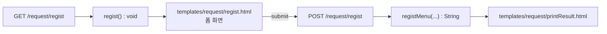
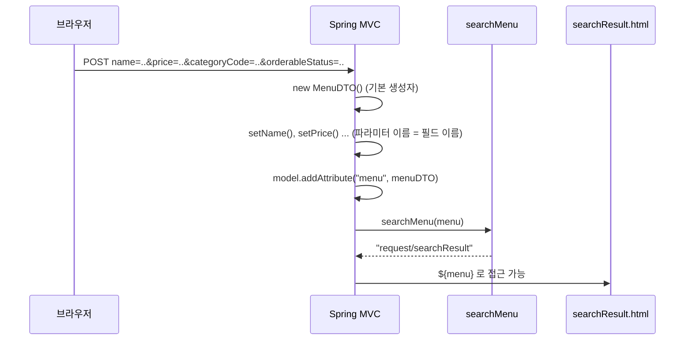

## 들어가며 (Situation)

08_Spring-Web-MVC 강의 `chap02-handler-method` 실습이다. [이전 글](2026-10-29-%EC%9A%94%EC%B2%AD%EC%9D%80-%EC%96%B4%EB%8A%90-%EB%A9%94%EC%84%9C%EB%93%9C%EB%A1%9C-%EA%B0%88%EA%B9%8C-%40RequestMapping%EC%9C%BC%EB%A1%9C-URL%EA%B3%BC-HTTP-%EB%A9%94%EC%84%9C%EB%93%9C-%EB%A7%A4%ED%95%91%ED%95%98%EA%B8%B0.html)에서 요청을 핸들러 메서드로 보내는 법을 익혔으니, 이번엔 그 메서드가 **요청에 담긴 값을 꺼내는 법**이다.

실습 도메인은 메뉴 관리다. 폼 3개(등록, 수정, 검색)를 만들고, 각각 다른 방식으로 파라미터를 받았다.

| 순서 | 요청 | 폼 | 파라미터 받는 방식 |
|------|------|----|-------------------|
| 1 | `/request/regist` | 메뉴 이름, 가격, 카테고리 | `WebRequest` |
| 2 | `/request/modify` | 수정할 이름, 가격 | `@RequestParam` |
| 3 | `/request/search` | 이름, 가격, 카테고리, 판매 상태 | `@ModelAttribute` + `MenuDTO` |

컨트롤러는 클래스 레벨에 `@RequestMapping("/request/*")`를 붙인 `RequestController` 하나다.

## 문제 상황 (Task)

서블릿에서는 폼 값을 이렇게 꺼냈다.

```java
// 예시 코드 (서블릿 강의 방식)
String name = request.getParameter("name");
int price = Integer.parseInt(request.getParameter("price"));
```

| 불편한 점 | 이유 |
|-----------|------|
| 값 하나에 한 줄 | 파라미터가 늘면 꺼내는 코드도 그만큼 는다 |
| 형변환을 직접 | `getParameter`는 항상 `String`을 돌려준다 |
| 파라미터 이름을 문자열로 반복 | `"name"` 오타가 나도 컴파일러가 못 잡고 `null`이 된다 |

chap01에서 `@PathVariable`이 `"3"`을 `int`로 바꿔준 것처럼, 폼 파라미터도 **Spring이 꺼내고 변환해서 매개변수로 넣어줄 수는 없을까?** 이번 챕터는 이걸 단계별로 줄여간다.

## 해결 과정 (Action)

### 0. 폼 화면 띄우기 — `void` 반환

각 기능은 GET으로 폼 화면을 띄우고, POST로 제출을 받는다. 그런데 GET 핸들러는 몸통이 비어 있다.

```java
/* comment.
*   View 를 return 하는 방식
*   1. String 타입으로 view 이름 return
*   2. void : /request/regist 요청경로 == view 경로*/

@GetMapping("regist")
public void regist() {}
```

반환 타입이 `void`면 Spring이 **요청 URL을 뷰 이름으로** 쓴다. `/request/regist` 요청 → 뷰 이름 `request/regist` → `templates/request/regist.html`. 그래서 템플릿 폴더 구조를 URL과 똑같이 `templates/request/` 아래에 맞춰 두었다.

| 반환 방식 | 뷰 이름 결정 | 실습 사용처 |
|-----------|-------------|-------------|
| `String` | 반환한 문자열 | POST 핸들러 (`"request/printResult"`) |
| `void` | 요청 URL | GET 핸들러 (`regist`, `modify`, `search`) |



### 1. `WebRequest` — 서블릿 방식 그대로

첫 번째 폼은 `name`, `price`, `categoryCode`를 보낸다.

```html
<form action="/request/regist" method="post">
    <input type="text" name="name"><br>
    <input type="number" name="price" step="1000" min="0"><br>
    <select name="categoryCode">
        <option value="1">식사</option>
        <option value="2">음료</option>
        <option value="3">디저트</option>
    </select><br>
    <button type="submit">등록</button>
</form>
```

받는 쪽은 `WebRequest`를 매개변수로 선언했다.

```java
@PostMapping("regist")
public String registMenu(Model model, WebRequest request) {
    // WebRequest 는 Servlet 환경의 HttpServletRequest 의 역할을 한다.
    // 사용자의 요청 정보가 해당 객체에 들어가게 된다.
    String menuName = request.getParameter("name");
    int menuPrice = Integer.parseInt(request.getParameter("price"));
    int categoryCode = Integer.parseInt(request.getParameter("categoryCode"));

    // service(menuName, menuPrice, categoryCode);

    String message = menuName + " 을(를) 신규 메뉴 목록 " +
            "" + categoryCode + "번 카테고리에" + menuPrice + " 원으로 등록 했습니다!";

    model.addAttribute("message", message);

    return "request/printResult";

}
```

매개변수에 선언만 하면 Spring이 알아서 넣어준다는 점은 새롭지만, 꺼내는 코드는 서블릿과 똑같다. 파라미터 3개에 3줄, `parseInt` 2번. `WebRequest`는 서블릿 API(`HttpServletRequest`)에 직접 의존하지 않는 Spring의 요청 추상화다.

주석 처리된 `// service(menuName, menuPrice, categoryCode);`는 꺼낸 값을 원래 서비스 계층에 넘겨야 할 자리다. 지금은 DB가 없어서 메시지만 만들었다.

### 2. `@RequestParam` — 꺼내고 변환까지 한 번에

두 번째 폼은 `modifyName`, `modifyPrice`를 보낸다.

```html
<form action="modify" method="post">
    수정할 메뉴의 이름 : <input type="text" name="modifyName"><br>
    수정할 메뉴의 가격 : <input type="number" name="modifyPrice"><br>
    <button type="submit">수정</button>
</form>
```

```java
@PostMapping("modify")
public String modifyMenu(Model model,
                         @RequestParam("modifyName") String name,
                         @RequestParam int modifyPrice)
{
    System.out.println("modifyName = " + name);
    System.out.println("modifyPrice = " + modifyPrice);
    return "request/printResult";
}
```

`getParameter` + `parseInt` 두 단계가 매개변수 선언 하나로 줄었다. 두 매개변수를 일부러 다르게 썼다.

| 작성 | 파라미터 이름을 어디서 가져오나 |
|------|-------------------------------|
| `@RequestParam("modifyName") String name` | 어노테이션에 적은 이름. 변수명은 자유 |
| `@RequestParam int modifyPrice` | **변수명** 그 자체 |

변수명을 이름으로 쓰려면 컴파일된 클래스에 매개변수 이름이 남아 있어야 한다. Spring Framework 6.1부터는 이를 위해 `-parameters` 컴파일 옵션이 필요한데, Spring Boot Gradle 플러그인이 `JavaCompile` 태스크에 이 옵션을 자동으로 넣어줘서 별도 설정 없이 동작했다.

실습 주석에 적어둔 주의점이 이 방식의 핵심 함정이다.

```java
/* comment.
*   @RequestParam 은 사용자의 request 에 들어있는
*   값을 손쉽게 꺼낼 수 있는 어노테이션이다.
*   단, 가장 주의해야 할 것.
*   - View 쪽에서 input 타입의 name 속성에 작성해둔
*   - 값과 변수명을 일치시키지 않으면 400 Bad Request 가
*   - 발생한다.
*  */
```

`@RequestParam`은 기본값이 `required = true`라서, 폼의 `name`과 이름이 안 맞으면 해당 파라미터가 "없는" 것으로 보고 `MissingServletRequestParameterException` → **400 Bad Request**를 낸다. `getParameter`가 조용히 `null`을 주던 것과 달리 바로 실패하는 셈이라, 오히려 오타를 빨리 발견할 수 있다.

`modify.html`에는 `modifyName2`, `modifyPrice2`를 `modifyAll`로 보내는 "메뉴 수정 폼2"도 있다. 컨트롤러에 `modifyAll` 핸들러가 없으니 제출하면 404가 난다. 정상 흐름과 오류 화면을 나란히 확인해보려고 남겨둔 폼이다.

### 3. `@ModelAttribute` — 파라미터를 객체 하나로

검색 폼은 값이 4개다. `@RequestParam`으로도 4줄이 된다. 그래서 폼 필드와 같은 이름의 필드를 가진 DTO를 만들었다.

```java
@NoArgsConstructor
@AllArgsConstructor
@Getter
@Setter
@ToString
public class MenuDTO {

    private String name;
    private int price;
    private int categoryCode;
    private String orderableStatus;

}
```

```html
<form action="search" method="post">
    검색할 메뉴 이름 : <input type="text" name="name"><br>
    검색할 메뉴 가격 : <input type="number" name="price"><br>
    <select name="categoryCode"> ... </select><br>
    검색할 판매 상태 : <input type="text" name="orderableStatus"><br>
    <input type="submit" value="검색하기">
</form>
```

```java
@PostMapping("search")
public String searchMenu(@ModelAttribute("menu") MenuDTO menu) {
    /* comment.
    *   ModelAttribute
    *   - 클래스자료형을 활용해서 사용자의 입력 값들을
    *   - 하나의 객체로 묶을 수 있다.
    *   ---
    *   Model 객체를 활용하지 않아도 forward 되는 페이지에서
    *   값들을 활용할 수 있다.
    *   ex) @ModelAttribute MenuDTO menu
    *   MenuDTO -> menuDTO
    *  */
    System.out.println("menu = " + menu);
    
    return "request/searchResult";
}
```

매개변수가 4개에서 1개로 줄었고, `Model`도 매개변수에서 사라졌다. `@ModelAttribute`는 두 가지 일을 한다.



1. **바인딩**: 요청 파라미터 이름과 같은 이름의 필드에 값을 넣고, `price`·`categoryCode`는 `int`로 변환한다.
2. **모델 등록**: 만든 객체를 자동으로 `Model`에 넣는다. 그래서 `model.addAttribute`를 안 써도 결과 화면에서 꺼낼 수 있다.

이때 모델에 들어가는 **이름**이 함정이었다. 주석에 적은 대로, 이름을 생략하면 클래스 이름의 첫 글자를 소문자로 바꾼 `menuDTO`가 된다. 실습 코드는 이 규칙을 확인하려고 일부러 어긋나게 두었다. `@ModelAttribute("menu")`로 이름을 지정해 놓고, 결과 템플릿은 `menuDTO`로 꺼낸다.

```html
<h3 th:text="${menuDTO.getName()}"> </h3>
<h3 th:text="${menuDTO.getPrice()}"> </h3>
```

| `@ModelAttribute` 작성 | 모델 key | `${menuDTO...}` 결과 |
|------------------------|----------|---------------------|
| `@ModelAttribute MenuDTO menu` | `menuDTO` | 정상 출력 |
| `@ModelAttribute("menu") MenuDTO menu` (현재 코드) | `menu` | `menuDTO`가 없어 `null`에 `getName()` 호출 → 템플릿 처리 오류 |

둘 중 하나로 맞춰야 한다. 템플릿을 `${menu.name}`으로 바꾸거나, 어노테이션의 이름을 지우거나. 참고로 Thymeleaf에서는 `getName()`을 직접 호출하지 않아도 `${menu.name}`처럼 프로퍼티 이름으로 쓰면 getter를 호출해준다.

### 4. 세 방식 비교

| 항목 | `WebRequest` | `@RequestParam` | `@ModelAttribute` |
|------|-------------|-----------------|-------------------|
| 파라미터 4개 받을 때 코드 | `getParameter` 4줄 | 매개변수 4개 | 매개변수 **1개** |
| 형변환 | `parseInt` 직접 | 자동 | 자동 |
| 이름 불일치 시 | `null` (조용히 실패) | **400 Bad Request** | 해당 필드만 기본값 (조용히 실패) |
| 화면에 값 넘기기 | `model.addAttribute` 필요 | `model.addAttribute` 필요 | 자동으로 모델 등록 |
| 어울리는 상황 | 헤더 등 요청 전체 정보가 필요할 때 | 값 1~2개 | 폼 전체, 값이 많을 때 |

`index.html`의 네 번째 버튼 `@RequestBody 이용`(`/request/body`)은 아직 핸들러가 없다. 폼이 아니라 요청 본문(JSON 등)을 통째로 받는 방식이라 다음 실습에서 이어질 것 같다.

## 결과 (Result)

| 항목 | `WebRequest` (regist) | `@RequestParam` (modify) | `@ModelAttribute` (search) |
|------|-----------------------|--------------------------|----------------------------|
| 받는 파라미터 수 | 3 | 2 | 4 |
| 값 꺼내는 코드 | 3줄 | 0줄 (매개변수 선언) | 0줄 (매개변수 1개) |
| `parseInt` 호출 | 2회 | 0회 | 0회 |
| `model.addAttribute` | 1회 | — | 0회 (자동 등록) |

받는 값은 늘었는데 꺼내는 코드는 3줄 → 0줄로 줄었다.

배운 점

- 핸들러 메서드는 매개변수에 **무엇이 필요한지 선언만** 하면 된다. 꺼내고 변환해서 넣는 건 Spring이 한다.
- 편해지는 만큼 **이름 맞추기**가 전부가 된다. 폼의 `name` 속성 ↔ `@RequestParam` 이름(또는 변수명) ↔ DTO 필드명 ↔ 템플릿의 모델 key가 한 줄로 이어져야 한다.
- 실패 방식이 방식마다 다르다. `@RequestParam`은 400으로 시끄럽게, `WebRequest`와 `@ModelAttribute` 필드는 `null`·기본값으로 조용히 실패한다.
- `void` 반환은 URL과 템플릿 폴더 구조가 같다는 약속 위에서만 동작한다.

## 더 학습하면 좋은 개념

- **`HandlerMethodArgumentResolver`** — `Model`, `WebRequest`, `@RequestParam`, `@ModelAttribute`를 매개변수에 넣어주는 실제 주체. 직접 구현하면 로그인 사용자 같은 값을 매개변수로 주입받을 수 있다.
- **`@RequestBody`와 `HttpMessageConverter`** — 폼(`application/x-www-form-urlencoded`)이 아닌 JSON 본문을 객체로 바꾸는 방식. `@ModelAttribute`와 바인딩 원리가 완전히 다르다.
- **`@RequestParam`의 `required`, `defaultValue`와 `Map` 받기** — 선택 파라미터 처리와 파라미터를 한 번에 받는 방법. 400을 피하는 정석적인 방법이다.
- **Bean Validation (`@Valid`, `BindingResult`)** — `price`에 문자를 넣으면 바인딩 오류가 난다. 입력 검증과 바인딩 오류를 화면에 돌려주는 방법.
- **DTO와 엔티티 분리** — `MenuDTO`처럼 화면 입력용 객체를 따로 두는 이유. 이후 서비스·DB 계층과 연결할 때 중요해진다.

## 참고 자료

- [Spring Framework Reference - Handler Methods: Method Arguments](https://docs.spring.io/spring-framework/reference/web/webmvc/mvc-controller/ann-methods/arguments.html)
- [Spring Framework Reference - @RequestParam](https://docs.spring.io/spring-framework/reference/web/webmvc/mvc-controller/ann-methods/requestparam.html)
- [Spring Framework Reference - @ModelAttribute](https://docs.spring.io/spring-framework/reference/web/webmvc/mvc-controller/ann-methods/modelattrib-method-args.html)
- [Spring Framework Reference - Return Values](https://docs.spring.io/spring-framework/reference/web/webmvc/mvc-controller/ann-methods/return-types.html)
- [Spring Boot Gradle Plugin - Reacting to the Java Plugin (-parameters)](https://docs.spring.io/spring-boot/gradle-plugin/reacting.html#reacting-to-other-plugins.java)
