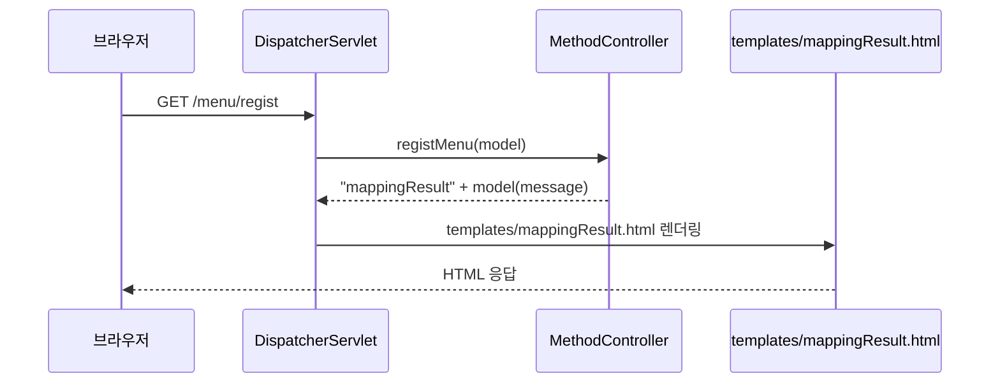
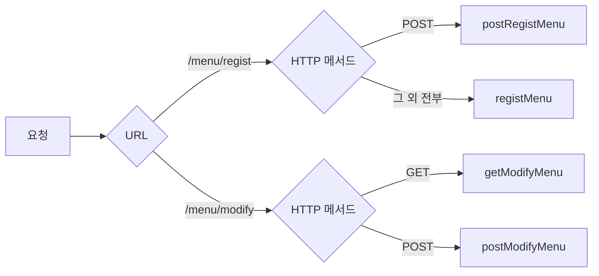

## 들어가며 (Situation)

08_Spring-Web-MVC 강의의 첫 두 챕터를 실습했다. 글도 챕터별로 두 편으로 나눴다.

| 순서 | 프로젝트 | 다룬 것 | 글 |
|------|----------|---------|-----|
| 1 | `chap01-request-mapping` | 요청 URL·HTTP 메서드를 핸들러 메서드에 연결 | 이 글 |
| 2 | `chap02-handler-method` | 핸들러 메서드에서 요청 파라미터 꺼내기 | 다음 글 |

프로젝트는 Spring Boot `4.1.2`, Java 21이고 의존성은 `spring-boot-starter-webmvc`와 `spring-boot-starter-thymeleaf` 두 개다. 포트는 `application.yaml`에서 `7777`로 바꿨다.

```yaml
server:
  port: 7777
```

실습 화면은 `static/index.html` 하나다. 버튼과 폼으로 `/menu/...`, `/order/...`에 GET·POST 요청을 보내고, 어느 핸들러 메서드가 받았는지 결과 페이지에 메시지로 찍는다.

## 문제 상황 (Task)

서블릿 강의에서는 URL 하나마다 서블릿 클래스를 만들고, 그 안에서 `doGet`·`doPost`로 HTTP 메서드를 나눴다. 응답할 화면으로 넘길 때는 `request.setAttribute()`로 값을 담고 `forward(req, res)`를 직접 호출했다.

| 서블릿에서 하던 일 | 불편한 점 |
|--------------------|-----------|
| URL마다 서블릿 클래스 + `@WebServlet` | 기능(등록, 수정, 삭제...)마다 클래스가 늘어난다 |
| `service()`가 `doGet`/`doPost`로 분기 | 메서드 이름이 HTTP 메서드에 묶여 있어 무슨 일을 하는지 안 드러난다 |
| `getRequestDispatcher(경로).forward(req, res)` | 응답 화면으로 넘기는 코드를 매번 반복 |

`MethodController` 맨 위 주석이 Spring MVC가 이걸 어떻게 바꾸는지 요약한다.

```java
/* comment.
*   Spring Boot App 은 Tomcat 이 내장되어 있다.
*   지금까지 사용자의 요청이 있으면 요청을 처리 할
*   Servlet 을 만들었다고 한다면,
*   Servlet 은 Http 요청을 받는 즉시 @Controller
*   어노테이션이 달린 클래스에 요청을 위임한다.
*  */
```

이제 서블릿은 내가 만들지 않는다. Spring이 만든 서블릿(`DispatcherServlet`)이 모든 요청을 받고, **어느 메서드로 보낼지**는 어노테이션으로 알려준다. 이번 챕터의 과제는 그 "알려주는 방법"을 익히는 것이다.

## 해결 과정 (Action)

### 1. 전체 흐름



서블릿에서 내가 하던 일(요청 분기, 값 담기, forward)이 각각 어노테이션, `Model`, 반환 문자열로 바뀌었다.

### 2. `@RequestMapping` — URL을 메서드에 연결

첫 핸들러 메서드는 `/menu/regist` 요청을 받는다.

```java
@Controller
public class MethodController {

    @RequestMapping("/menu/regist")
    public String registMenu(Model model) {

        System.out.println("동작하니?");

        model.addAttribute("message", "GET 방식의 메뉴 등록 핸들러 메서드 동작함..");

        return "mappingResult";
    }
```

여기서 새로 나온 것이 두 가지다.

**`Model`** — 컨트롤러에서 만든 값을 화면으로 넘기는 상자다. 실습 주석에서는 이렇게 정리했다.

```java
/* comment. model 객체
*   백엔드 서버에서 발생한 값을 담을 수 이는
*   Request 객체이다. key-value 형태로 값을
*   담을 수 있다.
*  */
```

서블릿의 `request.setAttribute("message", ...)`와 같은 자리다. 결과 화면에서는 Thymeleaf 문법 `th:text="${message}"`로 꺼낸다.

```html
<h3 th:text="${message}" ></h3>
```

**반환 문자열** — 어떤 화면으로 응답할지 정하는 것이 컨트롤러의 마지막 임무다.

```java
/* comment.
*   @Controller 계층의 마지막 임무는
*   사용자에게 어떤 응답을 해줄 것인지를 결정하는 것이다.
*   메서드의 반환타입을 String 으로 한 후, 문자열을
*   return 하면 resources/templates 가 자동으로 접두사,
*   .html 이 접미사로 설정된다.
*   Servlet -> forward(req, res)
*  */
```

`"mappingResult"`를 반환하면 `classpath:/templates/` + `mappingResult` + `.html`, 즉 `templates/mappingResult.html`이 응답 화면이 된다. 이 접두사·접미사는 Thymeleaf 스타터의 기본값이다.

| 서블릿 | Spring MVC |
|--------|------------|
| `request.setAttribute("message", v)` | `model.addAttribute("message", v)` |
| `req.getRequestDispatcher("/WEB-INF/views/result.jsp").forward(req, res)` | `return "mappingResult";` |
| `@WebServlet("/menu/regist")` | `@RequestMapping("/menu/regist")` |

### 3. 같은 URL, 다른 HTTP 메서드

`index.html`에서는 `/menu/regist`로 GET(버튼 `location.href`)과 POST(form)를 둘 다 보낸다. 서블릿이라면 `doGet`과 `doPost`로 나눴을 것을, `method` 속성으로 나눴다.

```java
// @RequestMapping : Servlet -> service() : get/post/delete
@RequestMapping(value = "/menu/regist", method = RequestMethod.POST)
public String postRegistMenu(Model model) {

    model.addAttribute("message", "POST 방식의 메뉴 등록 핸들러 메서드 동작함..");

    return "mappingResult";
}
```

여기서 짚고 넘어갈 점이 있다. 위의 `registMenu`는 메시지에 "GET 방식"이라고 썼지만, `method`를 지정하지 않았기 때문에 실제로는 **모든 HTTP 메서드**에 매핑된다. POST 요청이 `postRegistMenu`로 가는 건, 같은 URL이면 HTTP 메서드까지 지정된 매핑이 더 구체적인 것으로 우선 선택되기 때문이다. 만약 `postRegistMenu`가 없었다면 POST 요청도 `registMenu`가 받아서 "GET 방식의..."라고 찍었을 것이다.

> `@RequestMapping`은 HTTP 메서드를 지정하지 않으면 모든 HTTP 메서드에 매핑된다. (공식 문서 내용 요약)
> — [Spring Framework Reference - Mapping Requests](https://docs.spring.io/spring-framework/reference/web/webmvc/mvc-controller/ann-requestmapping.html)

`value`, `method`를 매번 쓰는 대신 `/menu/modify`에서는 축약 어노테이션을 썼다.

```java
@GetMapping("/menu/modify")
public String getModifyMenu(Model model) {

    model.addAttribute("message", "GET 방식의 메뉴 수정 핸들러 메서드 동작함..");

    return "mappingResult";
}

@PostMapping("/menu/modify")
public String postModifyMenu(Model model) {

    model.addAttribute("message", "POST 방식의 메뉴 수정 핸들러 메서드 동작함..");

    return "mappingResult";
}
```

| 작성 방식 | 매핑되는 HTTP 메서드 | 실습 위치 |
|-----------|---------------------|-----------|
| `@RequestMapping("/menu/regist")` | 전부 | `registMenu` |
| `@RequestMapping(value = ..., method = RequestMethod.POST)` | POST | `postRegistMenu` |
| `@GetMapping("/menu/modify")` | GET | `getModifyMenu` |
| `@PostMapping("/menu/modify")` | POST | `postModifyMenu` |

`@GetMapping`은 `@RequestMapping(method = RequestMethod.GET)`을 줄인 합성 어노테이션이다. 한 메서드가 한 HTTP 메서드만 받는 게 대부분이라 실무에서는 축약형을 주로 쓴다고 한다.



### 4. 클래스 레벨 매핑 — 공통 경로 묶기

`/menu/...`는 메서드마다 `/menu`를 반복해서 적었다. 주문 기능(`/order/...`)은 `ClassController`에서 클래스에 공통 경로를 붙였다.

```java
@Controller
@RequestMapping("/order/*")
public class ClassController {

    @GetMapping("/regist")
    public String registOrder(Model model) {

        model.addAttribute
                ("message", "GET 방식의 주문 등록 핸들러 메서드 동작");


        return " mappingResult";
    }
```

클래스의 `/order/*`와 메서드의 `/regist`가 합쳐져 `/order/regist`가 된다. 클래스 패턴이 `/*`로 끝나면 그 부분이 메서드 경로로 대체되는 식으로 결합된다(`PathPattern.combine` 규칙).

### 5. `@PathVariable` — URL 안의 값 꺼내기

`index.html`의 마지막 폼은 `/order/detail/3`으로 요청한다. 여기서 `3`은 쿼리 스트링(`?no=3`)이 아니라 **경로 자체**에 들어 있다.

```java
/* comment.
*   요청 경로 : / order/detail/3
*   3 : pathVariable 이라고 불리우며
*   요청 url 을 타고 서버로 넘어오는 값을 의미한다.
*  */
@GetMapping("/detail/{orderNo}")
public String pathVariable(Model model, @PathVariable("orderNo") int no) {

    model.addAttribute("message", no + "번 주문 상세조회!!");

    return "mappingResult";
}
```

`{orderNo}` 자리에 들어온 문자열 `"3"`을 Spring이 `int`로 변환해서 `no`에 넣어준다. 서블릿이었다면 `request.getRequestURI()`를 잘라서 `Integer.parseInt()`까지 직접 해야 했던 일이다.

### 6. 오류 화면 확인용으로 남겨둔 코드

`ClassController` 쪽에는 정상 동작이 아니라 **오류 화면을 확인해보려고** 남겨둔 코드가 있다. 그대로 실행하면 세 군데에서 실패한다.

| 위치 | 코드 | 결과 |
|------|------|------|
| 파일 위치 | `src/test/java/.../ClassController.java` | 테스트 소스라 앱 실행 시 컴포넌트 스캔에 안 잡힌다 → `/order/...` 전부 404 |
| `registOrder` 반환값 | `" mappingResult"` (앞에 공백) | `templates/ mappingResult.html`을 찾게 된다 → 템플릿 없음 오류 |
| `index.html` 버튼 | `/order/modify`, `/order/delete` | 매핑된 메서드가 없다 → 404 |

첫 번째는 chap02(Spring Core)에서 배운 스캔 범위와 이어진다. `@SpringBootApplication`이 스캔하는 건 `src/main/java`의 `com.wanted.requestmapping` 이하인데, `src/test`의 클래스는 테스트 실행 때만 클래스패스에 올라간다.

## 결과 (Result)

| 항목 | 서블릿 | Spring MVC (chap01) |
|------|--------|---------------------|
| `/menu/regist`, `/menu/modify` × GET/POST 4개 요청 처리 | 서블릿 클래스 2개 + `doGet`/`doPost` 4개 | **컨트롤러 1개**에 메서드 4개 |
| HTTP 메서드 구분 | 메서드 이름(`doGet`/`doPost`) | 어노테이션(`@GetMapping`/`@PostMapping`) |
| 응답 화면 지정 | `forward(req, res)` 직접 호출 | 문자열 반환 1줄 |
| 공통 경로 | 서블릿마다 반복 | 클래스 레벨 `@RequestMapping` 1번 |
| URL 안의 값 | URI 직접 파싱 | `@PathVariable` |

배운 점

- 404(매핑 없음)와 템플릿 오류(뷰 이름 틀림)는 원인이 다르다. 오류 화면을 일부러 띄워 보면 어느 단계에서 실패했는지 구분하는 눈이 생긴다.
- 서블릿이 사라진 게 아니라 `DispatcherServlet` 하나로 합쳐졌다. 나는 **어느 메서드로 보낼지**만 어노테이션으로 표시한다.
- `@RequestMapping`에 `method`를 안 쓰면 "GET만"이 아니라 "전부"다. 메서드 이름이나 메시지가 매핑 조건이 되지는 않는다.
- 뷰 이름은 그냥 문자열이라 공백 하나도 경로가 된다. 컴파일러가 잡아주지 않는다.
- 컨트롤러도 결국 Bean이다. 스캔 범위 밖(`src/test`)에 두면 아무리 어노테이션을 붙여도 요청이 오지 않는다.

[다음 글](2026-10-29-request.getParameter%EB%8A%94-%EC%9D%B4%EC%A0%9C-%EA%B7%B8%EB%A7%8C-%ED%95%B8%EB%93%A4%EB%9F%AC-%EB%A9%94%EC%84%9C%EB%93%9C%EB%A1%9C-%EC%9A%94%EC%B2%AD-%ED%8C%8C%EB%9D%BC%EB%AF%B8%ED%84%B0-%EB%B0%9B%EA%B8%B0.html)에서는 요청을 받은 핸들러 메서드가 폼 데이터를 꺼내는 방법을 비교한다.

## 더 학습하면 좋은 개념

- **`DispatcherServlet`과 `HandlerMapping` / `HandlerAdapter`** — 어노테이션만 붙였는데 메서드가 호출되는 이유. Front Controller 패턴이 내부에서 어떻게 요청을 찾아 넘기는지 알면 404·405 원인을 바로 짚을 수 있다.
- **`ViewResolver`** — `"mappingResult"`라는 문자열이 `templates/mappingResult.html`이 되는 과정. 접두사·접미사를 바꾸거나 JSP와 섞을 때 필요하다.
- **REST API 설계와 HTTP 메서드 의미** — GET/POST 외에 PUT/PATCH/DELETE가 있다. `/order/delete`를 POST로 보내는 대신 `DELETE /order/3`처럼 설계하는 방식과 `@PathVariable`이 자연스럽게 이어진다.
- **`@RequestMapping`의 다른 조건 (`params`, `headers`, `consumes`, `produces`)** — URL·메서드 말고도 요청을 나누는 기준이 있다.
- **`PathPattern`과 `AntPathMatcher`** — `/order/*`, `/**`, `{name:정규식}` 같은 패턴 문법. Spring 6부터 기본 매처가 `PathPattern`으로 바뀌었다.

## 참고 자료

- [Spring Framework Reference - Mapping Requests](https://docs.spring.io/spring-framework/reference/web/webmvc/mvc-controller/ann-requestmapping.html)
- [Spring Framework Reference - DispatcherServlet](https://docs.spring.io/spring-framework/reference/web/webmvc/mvc-servlet.html)
- [Spring Framework Javadoc - PathPattern](https://docs.spring.io/spring-framework/docs/current/javadoc-api/org/springframework/web/util/pattern/PathPattern.html)
- [Spring Boot Reference - Template Engines](https://docs.spring.io/spring-boot/reference/web/servlet.html#web.servlet.spring-mvc.template-engines)
